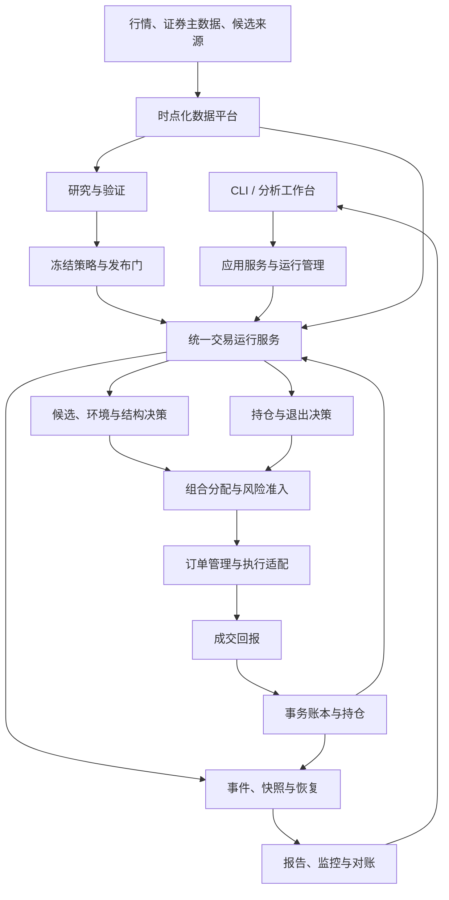
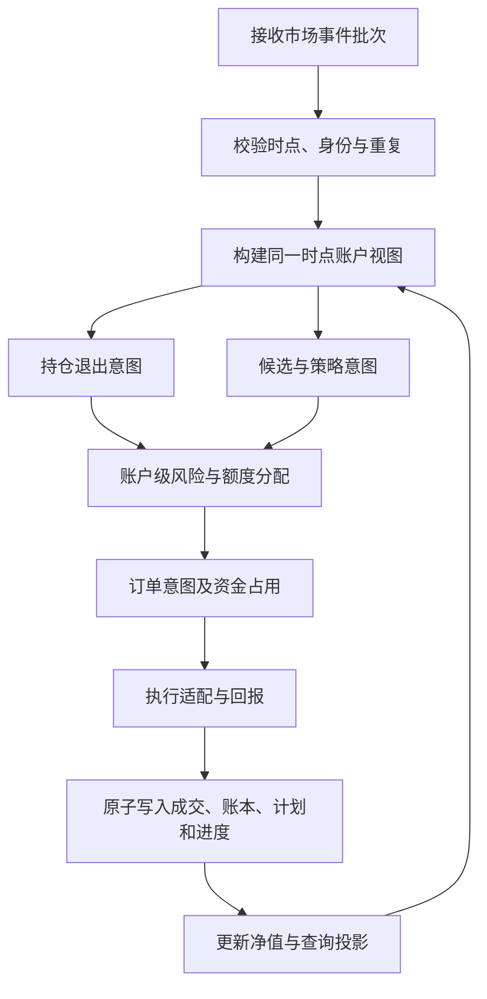
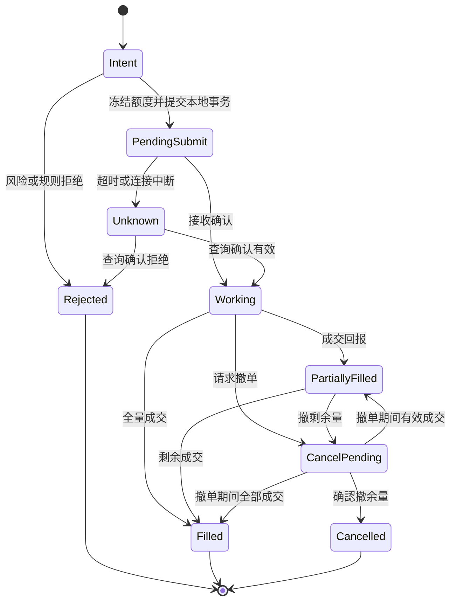
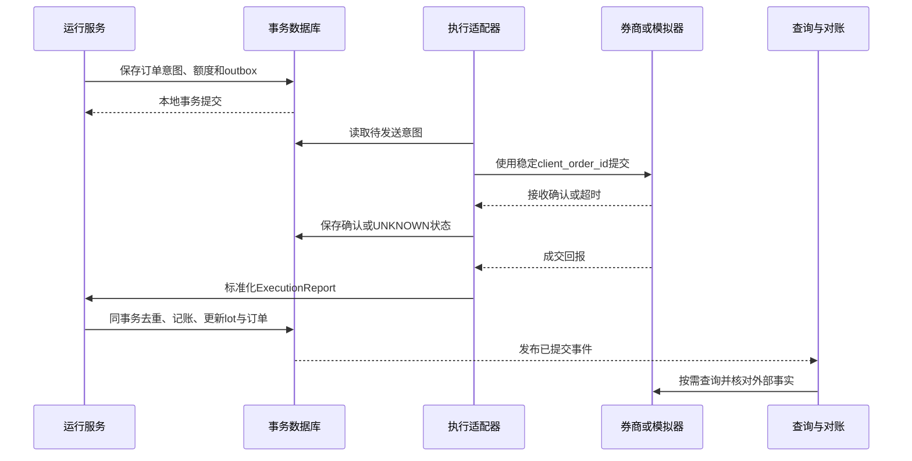
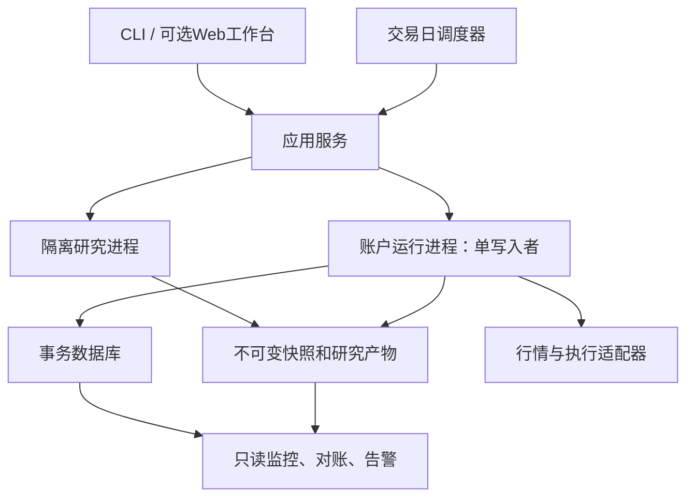

# price-action-lab：完整交易系统架构蓝图与第五轮复审

版本：架构建议 v1.0 ｜ 日期：2026-10-13（北京时间）  
审阅提交：`8618b34c55801450efa5d3af4b258f1a78621859`，2026-10-13 12:36:36 +08:00。  
上轮基线：`fb5dbee1e547838ec5b7d46fd81aa9c23ff3c9f4`。

[固定代码版本](https://github.com/RaiderYi/price-action-lab/tree/8618b34c55801450efa5d3af4b258f1a78621859) · [本轮差异](https://github.com/RaiderYi/price-action-lab/compare/fb5dbee1e547838ec5b7d46fd81aa9c23ff3c9f4...8618b34c55801450efa5d3af4b258f1a78621859)

本文同时回答三个问题：现在实际做到了什么；完整系统应该如何组织；如何从当前代码迁移到目标架构。标为“目标/建议”的设计不是现有实现。本文不修改仓库业务代码，也不执行真实交易。

## 0. 结论与当前进度

**本轮已有真正的公开入口交易正例，但尚未具备可靠的持续组合交易能力。后续应围绕统一运行状态、时点正确性和账户事务边界建设。**

在独立检出中，默认测试实际为 **526 passed、3 failed**，不是状态文档中的 529 全通过。三个失败来自仓内冻结验收包：6 个文件的 manifest hash 都对应 CRLF 字节，而 Git 存储的是 LF 字节。把同一份 Git 文件转成 CRLF 后，6 个 hash 均匹配，已定位为换行约定不一致。另有 53 个 integration 测试文件仍被默认排除。

为继续验证业务，我在临时目录使用仓内 build_pack 重新生成验收包，没有修改提交中的文件。结果：

- `backtest` 经真实引擎产生 `ARMED → FILL:8300@10.0 → EXIT_STOP:8300@8.5`。
- 期末现金/NAV 为 **987,476.3375**，CLI 展示 **987,476.34**。
- 系统自产事件与账本快照执行 `reconcile` 成功。
- 这是合成场景的工程正例，不是策略超额收益证据。

同时复现了必须解决的架构问题：paper 重启持仓消失；分日增量运行与整段回放不同；未来日线影响过去决策；写成交日志失败后账本已经变化；多批持仓的计划与实际卖出 lot 错配。组合分配器与熔断尚未接入交易主链，这一缺口本轮文档已有如实登记。

**阶段判断：** M1 单笔闭环有实质进展但尚不整体通过；M2 完整组合内核不通过；M3 持续 paper 未达到；M4 超额收益与 M5 实盘仍待后续验证。无需推倒重写全部组件，但需要调整主干架构。

## 1. 系统目标与首版边界

### 1.1 最终要交付的产品

一套能够每天完成以下工作的交易系统：

1. 从可靠数据构建当时可交易的股票池，识别数据缺失和异常。
2. 通过公开基线或五模型提供候选，结合价格行为和环境生成有依据的计划。
3. 在账户整体风险约束下决定是否交易、交易多少、何时失效。
4. 跟踪委托、部分成交、持仓和全部退出，不把触价等同于成交。
5. 保存现金、费用、持仓、净值、决策与操作证据，能够重启恢复和日终对账。
6. 使用同一交易内核开展研究、模拟与经授权的真实执行，持续验证扣除成本后的收益。

“具有超额收益”是研究与运行验证目标，不能由模块齐全或通过测试推出。系统必须能够诚实地输出 PASS、FAIL 或 INCONCLUSIVE，并保留负结果。

### 1.2 建议首版范围

| 维度 | 首版建议 | 后续扩展 |
|---|---|---|
| 市场与方向 | 延续项目 A 股、现金账户、多头路线；按支持清单启用板块与证券 | 其他资产或方向另建规则版本 |
| 决策周期 | 30m 执行结构、日线背景；按明确策略定义扩展周线背景 | 增加周期需独立验证 |
| 候选来源 | 公开可解释基线先落地，私有五模型走独立适配器 | 更多候选来源不改变核心订单/账本 |
| 策略 | 先选已定义清楚的少量 H2/突破策略完成闭环 | 其他结构按独立 strategy_id 验证后启用 |
| 运行方式 | 历史回测、离线 paper、实时 paper，最后接实盘 | 多账户可在单账户稳定后增加 |
| 部署 | Python 模块化单体、账户单写入者、事务数据库、不可变行情文件 | 负载或组织边界明确后再拆服务 |
| 界面 | CLI 完整可用，随后增加查询与操作页面 | 图表和交互基于同一读模型 |

市场规则、日历、费率及券商支持的委托类型必须版本化并核验；本文没有把仓内示例参数认定为当前全部市场的正式规则。

## 2. 总体架构：研究、交易运行、数据与证据三部分



这是一张目标逻辑架构图，不表示每个框都应部署成独立服务。首版可全部在同一个代码库和进程体系内，由明确接口隔离职责。

核心约束是：**一个账户只有一套有效状态；所有交易入口通过同一运行服务；所有经济变化通过统一成交与账本事务；所有策略输入来自同一时点化数据视图。**

## 3. 模块职责、输入输出与代码归属

| 模块 | 职责与主要输入 | 输出 | 对现有代码的处理 |
|---|---|---|---|
| 运行与应用服务 | 接收 scan/backtest/paper/live/reconcile 命令；创建或恢复运行上下文 | run/session、状态与产物索引 | 从 pal_cli.py 提取 application 服务；CLI 只解析参数和显示结果 |
| 数据接入 | 拉取行情、证券属性、日历、公司行动；记录来源、单位与延迟 | 原始快照、质量结果 | 保留 data 组件，补 provider 和实际入口 |
| 时点化数据视图 | 以 asof、证券、周期读取当时可知且有效的数据 | KnownFacts / MarketBatch | 把散落过滤集中，覆盖环境、信号、选股和估值 |
| 股票池与候选 | 先构建当时可交易池，再调用基线/五模型，去重并保留来源 | CandidateSet | selection/baselines/providers/merge 接入主链，禁止所有清单股票被暗称“已选股” |
| 环境评估 | 市场/行业/个股背景和必要确认滞后 | RegimeAssessment | context/regime 保留；输入只读 KnownFacts |
| 策略与结构 | 摆点、计数、突破/跟随、准入、失效 | Decision、SetupProposal | signals/engine 拆开计算与状态提交，复用已有检测组件 |
| 计划与定价 | 原始交易坐标的 entry/stop/target、有效期、适用退出策略 | TradePlan | pricing 保留并增加价格/规则版本、原始风险 |
| 组合与风险 | 所有候选争夺同一账户额度；存量持仓与在途委托共同约束 | Allocation、Reservation、RiskDecision | allocator 接入统一批次；risk 不再由每票私算全账户敞口 |
| 订单管理 OMS | 生命周期、幂等提交、修改/撤单、部分成交、未知状态 | OrderIntent、OrderEvent | 从 orchestrator 的局部 Order 提取为持久服务 |
| 执行适配 | 历史撮合、paper 撮合、券商回报统一协议 | ExecutionReport / Fill | fill_models 纳入接口，移出策略计算 |
| 持仓与退出 | 按 position/lot/plan 管理初始风险、可卖量、退出和剩余风险 | ExitIntent | position_plans 与 lot_id 明确关联，接入 ExitPolicyEngine |
| 账本 | 唯一执行现金/费用/持仓变动、公司行动与资金流水 | AccountState、NAV | ledger 迁入事务边界；禁止 CLI 直接赋 cash |
| 持久化与恢复 | 领域事件、状态、消费进度、checkpoint、outbox | 可恢复 session | EventStore 演进为事务存储接口；JSONL 作为导出/审计格式 |
| 查询、解释与报告 | 从持久状态投影，区分未评估/拒绝/待触发/在途/持仓/已退出 | 看板、日报、逐笔证据 | reporting 只读，不自行推进交易 |
| 研究评估 | 冻结试验、样本外回放、基准、归因和收益裁决 | ExperimentResult、发布证据 | research 复用运行服务与执行模型，不维护另一套交易逻辑 |
| 运维与控制 | 调度、健康、告警、对账、备份、停开仓与恢复 | OperationalEvent | 新增 operations；控制动作有账户范围和审计记录 |

模块之间传递结构化领域对象，不再依靠 `FILL:...` 等字符串解析关联。字符串仍可作为人类日志，但不是业务事实源。

## 4. 四种运行方式共用什么、区别在哪里

| 方式 | 输入 | 执行适配 | 状态与产物 | 限定行为 |
|---|---|---|---|---|
| scan 分析 | 指定 asof 的数据与候选、可选账户只读快照 | 不创建执行适配 | 决策、待确认/待触发计划、拒绝原因 | 不推进历史成交，不改账户现金和持仓 |
| backtest | 冻结的历史数据/候选/日历，确定性事件时间 | HistoricalFillSimulator | 隔离模拟账户、完整事件、NAV、研究结果 | 不调用真实委托接口；期末未平仓估值 |
| paper | 离线可重放事件或实时行情、同一候选/上下文协议 | PaperExecutionAdapter | 持续模拟账户，可重启继续 | 与 backtest 使用同一决策/风控/记账代码 |
| live | 实时已知事实、批准的策略版本、实际账户 | BrokerAdapter | 真实订单回报、账户和券商对账 | 外部状态不确定时先查询/对账，不盲目重发 |

“同一内核”不是都构造一个同名类，而是同一事件流通过同一输入解析、状态迁移、风险校验和记账逻辑。scan 只调用决策与计划服务，不调用交易推进服务。

运行模式的差异集中在事件来源、执行适配、账户隔离与允许的操作权限。使用者不应为了 paper 自己补候选、手工恢复计划，或在 CLI 中修改账本。

## 5. 日常业务流程

### 5.1 盘前：准备当日运行上下文

1. 验证交易日历、证券可交易状态、公司行动、费率与价格规则版本。
2. 读取昨日最终账本与未完成订单；真实执行模式先与券商对账。
3. 拉取并校验缺失行情，重建每票跨日窗口与日线/周线背景。
4. 从 as-of 股票池生成候选，合并来源，保留 available_at、eligible_from、expires_at。
5. 恢复已有持仓退出策略与风险预算；无论股票是否仍在新候选池中，都继续管理已有仓位。
6. 输出运行就绪状态：READY / DATA_DEGRADED / RECONCILIATION_BLOCKED / HALTED 等，并给出具体原因。

### 5.2 盘中：先处理已存在风险，再决定新增风险



止损/止盈的委托是执行意图，只有 Fill 能改变经济账本。减风险订单同样必须遵守可卖量、真实市场可执行性与回报事实，但不能被“停止新增风险”开关无条件冻结。

### 5.3 盘后：核对、解释与准备下一日

- 完成现金、订单、成交、费用、持仓 lot 和可卖量对账；仅比余额和总股数不足以证明计划正确。
- 记录初始 NAV、各交易日收盘 NAV、在途与未平仓风险，费用不可重复计入。
- 输出候选去向和每笔交易证据，保留未成交、部分成交、卖不出及策略失效等情况。
- 保存 checkpoint 和数据引用，核验可恢复；次日计划的 eligible_from 不能早于其真实生成与可交易时点。
- 研究任务异步读取已冻结数据，不修改正在运行的策略版本。

## 6. 领域对象与接口契约

### 6.1 主键和对象

| 对象 | 最少字段 | 规则 |
|---|---|---|
| Instrument | instrument_id、exchange、board、名称、属性有效期 | 证券身份来自主数据；不能默认所有代码属于同一交易所 |
| MarketBar | instrument/timeframe、start/end、available_at、received_at、OHLCV/amount、单位、is_final、revision | 时间顺序与可知时间独立，修订不覆盖旧版本 |
| SnapshotManifest | schema、文件清单和 hash、证券/日历/规则引用、数据范围、来源和生成信息 | 声明文件必须齐全，不得静默缺失；额外文件也要纳入声明或拒绝 |
| Candidate | candidate_id、instrument_id、来源列表、available/eligible/expires、版本、来源估计和证据 | 候选生成与可交易时间分开；多来源不等于多份资金 |
| Decision | decision_id、input_snapshot_id、rule/config版本、asof、outcome、reason、evidence | 可解释、可重算，缺上下文必须明确 |
| SetupState | setup_id、strategy_id、family、instrument、state、formed/confirmed/effective/expires | 区分形成、确认、武装、触发；过期不可原地复活 |
| TradePlan | plan_id、setup_id、entry类型/价格、stop、targets、失效条件、exit_policy、初始风险 | 不把信号分数转换为未经校准的概率 |
| Allocation/Reservation | account、plan、批准数量、冻结现金、风险占用、有效期 | 对存量及在途统一约束，撤单/成交按事实释放或转换 |
| Order | account/order/client_order_id、plan、side/type、qty、limit/stop、状态、累计量、版本 | 原委托量和已成交量分开；订单可关联多笔 fill |
| Fill | fill_id、order_id、证券/方向、qty/price、事件时间、费用、来源 | 经济效果按唯一 fill_id 幂等；不同 fill 不因同 order_id 被拒 |
| PositionLot | lot_id、fill_id、plan_id、qty、cost、acquired/sellable_from、初始风险 | 可卖量按 lot，不可用新批计划任意卖掉老批次 |
| ExitPolicyState | position/lot/plan_id、active/pending stop、targets、剩余量、持有时钟 | 移动止损的生效时点明确；只更新本策略所属数量 |
| AccountState | cash、cash_available/reserved、持仓、风险暴露、NAV、last_seq | 单一权威状态；不能从多份独立摘要拼成账户 |
| RunContext | run_id、session_id、account_id、mode、strategy/config/data/calendar/rule版本 | run 是一次执行；session/account 可跨重启，不能每次重新初始化资金 |
| Checkpoint | account/session、last_committed_seq、领域状态、窗口引用、校验和 | 恢复后继续运行，不只是展示余额 |

### 6.2 建议公共接口

以下为目标契约，名称可调整，职责不可混合：

```python
facts = market_data.view(asof, instruments, required_timeframes)
candidates = candidate_service.generate(facts, universe, provider_config)
proposal = decision_service.evaluate(facts, candidates, strategy_state, config)
allocation = portfolio_service.allocate(proposal.intents, account_view, risk_view)
submission = order_service.stage(allocation, unit_of_work)
execution_gateway.submit(submission)  # 本地事务提交之后，由 outbox 驱动
runtime.apply_execution_report(report)  # 幂等更新订单、账本、lot、计划
runtime.handle_market_batch(batch)
runtime.restore(session_id)
report_service.project(run_id, asof)
```

decision_service 应只返回决策及建议状态变化；是否提交由运行服务在统一边界决定。避免本次出现过的“为了查询环境先执行一次带副作用的引擎”问题。

## 7. 状态归属：每种状态只能有一个权威所有者

| 状态 | 权威所有者 | 可否重建 | 明确禁止 |
|---|---|---|---|
| 原始行情和修订 | 数据快照仓 | 从原始版本读取 | 修改历史文件后仍沿用同一 snapshot_id |
| 跨日历史窗口 | 运行上下文/数据视图 | 按输入引用与 asof 重建 | 每次 run() 局部清空而不加载旧窗口 |
| 信号与计划 | StrategyStateRepository | 事件/快照重放 | engine.book 与 orch.armed 无一致迁移协议 |
| 在途订单与冻结额度 | OMS + ReservationRepository | 回报和事件重建 | 只放在方法局部变量中 |
| 现金与持仓 lot | LedgerRepository | 同一账本规则重放 | CLI 直接赋 ledger.cash；忽略 lot 恢复 |
| 退出状态 | Position/ExitRepository | 与 lot 对应重建 | 只恢复总股数、不恢复 stop/target/时钟 |
| 已处理事件游标 | 事务提交记录 | 已提交 seq | 业务未提交就标 consumed |
| 报告和图表 | 查询投影 | 可完全重建 | 用报告 JSON 反向覆盖业务账户 |
| 外部委托状态 | 券商事实 + 本地关联记录 | 查询/对账 | 超时被当成“肯定没有发出” |

这张表是后续架构重构的核心验收依据。当前问题多来自同一个事实被不同模块分别维护，且没有一致的提交和恢复规则。

## 8. 时间架构与因果边界

### 8.1 四种时间

- event_time：市场事件实际发生的时间。
- available_at：该信息最早可被策略合法知道的时间，含供应商延迟。
- received_at：本进程收到事件的时间，用于运维、延迟和审计。
- effective_at：决策、参数或订单开始生效的时间。

所有策略模块只消费 `available_at <= decision_asof`、证券/周期匹配且满足 final 政策的数据。这个约束必须由数据视图统一执行，不能要求每个调用者自行记得过滤。

### 8.2 30m 回放的最低执行约定

只有 OHLCV 时无法知道棒内精确路径。首版应冻结清楚的保守撮合政策：

1. 收盘后形成的信号不得在同一根棒的早先价格成交。
2. 用于整根棒撮合的订单，应在该棒可执行区间开始前已生效；若只有棒中才生效但缺更细行情，应延后或使用明确保守假设，不能使用整个棒的 high/low 回填。
3. 订单在开盘触发时的定仓不能偷看该棒收盘价与未来成交量；按实际可获得粒度定义前置额度、成交量上限及回报时点。棒总量只能作为事后模拟容量约束，不冒充开盘已知信息。
4. 同棒止损和目标都触达，记录路径不确定并按冻结规则处理，不挑选最优路径。
5. 用后续收盘确认突破，就要在确认后才允许相应入场；若采用预挂条件单，必须作为不同的策略时序注册。
6. 日线聚合 available_at 至少为正式收盘可用时刻与所有输入 available_at 的最大值。

### 8.3 多票事件批次

同一可知时点的多票事实应形成确定性批次：固定事件阶段、稳定排序键、批次完成条件与缺票处理。候选排序、风险分配不能意外依赖文件名或网络先到哪一只票。

确定性不能靠等待未来数据实现。对实时迟到事件，按事先规定的延迟窗口或独立更新政策处理；对已提交交易不回溯改写。历史数据修订产生新快照和新研究运行。

## 9. 策略、选股与知识库如何整合

### 9.1 候选不等于买入计划

可交易股票池负责“哪些证券在这个时点允许考虑”；候选来源负责“优先研究哪些”；价格行为决策负责“结构是否成立”；组合与执行负责“账户此刻能否承担并实现这笔交易”。这四项分别留证据。

公开基线应从完整、时点正确的股票池生成。私有五模型输出保留来源模型、bucket、原始 stop/target、启发式 WR/EV 和协议版本；它们是输入证据，不应自动覆盖系统风险政策或被当作已验证胜率。

### 9.2 策略单元

每个 strategy_id 至少包含：适用市场/方向/周期、候选条件、环境条件、结构定义、确认规则、激活方式、入场订单类型、止损/目标、退出政策、失效/冷却、风险参数及证据版本。

H2、突破、旗形等可以共享数据、摆点和价格服务，但不能共享含混的“强信号”标签。规则卡、旧实现和新实现之间必须有明确映射；规则名称相同而定义不同时，使用不同 implementation_version。

### 9.3 AI 和知识库的职责

知识库用于规则溯源、争议定义、研究假设和报告解释。AI 可以整理候选解释、提出研究变体、生成测试和复盘问题；运行时的仓位、订单、可卖量及记账由确定性规则计算。若引入模型预测，需要独立版本、输入快照、校准结果和样本外验证。

AI 不应在运行期间静默改参数，或用自然语言报告“推测”真实订单状态。策略改动进入研究与发布流程后才作用于后续事件。

## 10. 组合风险、订单与持仓管理

### 10.1 组合层必须计算的视图

| 风险维度 | 应计入的内容 |
|---|---|
| 可用现金 | 现金余额减已冻结订单额及费用预算 |
| 单票暴露 | 既有本票持仓 + 本票在途买单 + 本批新增额度 |
| 行业暴露 | 所有同行业持仓和在途额度，使用当时有效行业映射 |
| 总仓位 | 全账户持仓与在途承诺，明确估值质量 |
| 持仓数量 | 现有证券数 + 在途首次开仓证券数，增持旧票不重复占新票槽位 |
| 单笔风险 | 以实际可执行价/保守上界计算，与原始 stop、费用和数量相乘 |
| 隔夜/跳空风险 | 无法立即退出、停牌、价格限制等情景下的压力损失 |
| 回撤与日内损失 | 全账户已实现/未实现变化、时点一致 NAV 与日切基线 |
| 数据与操作风险 | stale/missing marks、账户对账异常、未知委托、失联、人工停开仓 |

风险不足时输出拒绝或缩量原因，不用“单票市值=全账户持仓市值”的近似代替真实组合输入。停止新开仓与处理现有风险分开。

### 10.2 订单状态机



图为生命周期主干，实际适配还需处理乱序回报。撤单请求不等于撤单完成；撤单与成交竞态按照券商真实序号/时间对账，不能简单丢弃已发生的成交。改单以版本或撤旧建新表达，不能覆盖旧事实。

### 10.3 持仓计划与 lot

必须选定并显式编码“按策略/计划管理，还是按账户聚合管理”。建议首版采用 **plan 对应逻辑持仓、fill 对应 lot**：退出意图包含 position_id/plan_id/目标 lot 集合，账本按允许的 lot 分配规则扣减。

如果业务选择账户级统一止损，则应显式把相关 lot 纳入同一退出策略并留下版本事件。禁止新买入批次的 stop 命中后，卖出另一旧批次并留下错误计划。

每个退出包含：触发条件、最早执行时间、剩余数量、可卖量、价格/流动性约束、重试/失效政策。未能卖出时继续记录敞口；分红送转同时调整 lot、现金、成本和适用计划坐标，不能只改研究 K 线。

## 11. 事务、恢复与外部执行

### 11.1 本地业务提交

推荐将以下内容放在同一数据库事务内：去重记录、领域事件、订单状态、资金冻结、成交、现金流水、position lot、退出状态、已提交事件游标。对大型输入行情只存引用，不把全部历史重复塞进事务。

一次 Fill 处理的顺序：校验 identity 和数量 → 检查重复 → 计算领域变更 → 同事务保存 fill/费用/现金/lot/plan/order/游标 → 提交后更新或重载内存投影。失败则整组不提交，不出现“账本已买入，成交记录不存在”。

数据库中还需区分账户初始创建与进程启动。重启不得再次追加会把现金归回初始值的 session_init。

### 11.2 外部委托不能与本地数据库假装原子提交



outbox 是与订单意图一起落盘的“待发送记录”。进程可以至少一次重试传输，但通过稳定订单标识、成交去重和对账保证不重复经济效果；不承诺网络层“恰好一次”。外部提交结果不明时，保留 UNKNOWN 并查询，不能直接创建新单。

### 11.3 必须恢复哪些内容

恢复清单：现金及流水、持仓 lot/可卖日、已成交与在途订单、预留额度、armed/expired/cooldown、退出 active/pending stop、持有时钟、事件消费进度、每票历史窗口引用、最新有效报价及质量、当日/历史峰值风险基线、策略/配置版本。

恢复过程：获取账户写入权 → 读最后完整 checkpoint → 重放已提交后续事件 → 验证内部不变量 → 查询外部未决委托 → 对账 → 进入 READY。异常进入 RECOVERY_BLOCKED，已有风险按既定操作流程处置，不能展示“恢复成功”却把持仓置零。

历史重放用于校验时必须写隔离账户/目录，不得重发真实委托。

## 12. 数据存储与版本设计

### 12.1 建议存储分工

| 存储 | 放什么 | 不放什么 |
|---|---|---|
| 不可变文件快照 | 原始行情、证券与日历版本、候选输入、manifest | 当前可变账户状态 |
| 事务数据库 | accounts、sessions、orders、fills、lots、cash、reservations、strategy/exit state、event_log、inbox/outbox、checkpoints | 多份互相独立的“真实账本” |
| 查询投影 | 每日计划、持仓视图、NAV、风险和研究汇总 | 不能成为改变持仓的输入源 |
| 产物目录 | 每个 run 的版本、导出、报告、对账和验证证据 | 未带输入版本的孤立截图/收益数字 |

首版单机、单账户写入者场景可采用 SQLite 事务存储；并发读取与写入要有边界，不把 JSONL 多次 append 当成跨对象原子事务。SQLite 官方说明提供原子提交机制，同时事务/WAL 写入存在单写入者约束，因此该建议适合当前模块化单体起点；需要多主机写入时再评估数据库迁移。[官方原子提交说明](https://www.sqlite.org/atomiccommit.html)、[官方事务说明](https://www.sqlite.org/lang_transaction.html)。

此处建议是架构判断，不是称 SQLite 自动解决业务幂等、券商竞态或缺失状态。必须通过真实故障注入验证选定实现及配置。

### 12.2 数据库约束最低要求

- fills 在 account/source/fill_id 维度唯一；order_id 是关联键，不限制一单多成交。
- client_order_id 在目标账户维度稳定唯一；订单状态事件有事件 ID 或版本，不能只允许写一次 order。
- lot_id 和 plan_id 显式关联；扣减数量不得超出对应可卖量。
- inbox 在 account/session/source_event_id 维度去重；只有完成提交才推进 last_committed_seq。
- cash movement 引用唯一业务事件，金额使用明确精度与舍入规则，重放不得改变费用。
- event_log 带 event_id、类型、schema_version、sequence、相关对象 ID、时间与 payload。
- reservation 的释放/转换必须关联订单和事件，不能每批计算完即丢弃。

### 12.3 快照与运行指纹

统一 UTF-8 和固定 LF 序列化后计算文件 hash，并在 Git/生成工具中保持一致。hash 校验覆盖“文件内容”和“文件集合”：声明文件丢失必须失败，未声明新增文件不能被悄悄用于策略。

RunManifest 至少绑定 commit、strategy_version、完整 config_hash、data_snapshot_hash、candidate_snapshot_hash、calendar_version、market_rule_version、fill_model_version、fee_model_version、account/session、schema_version、运行模式和验证状态。

这些字段用于复现，不应只存 `cli-backtest-v1` 这样的显示名称。改变撮合、成本或候选集合都应形成新实验版本。

## 13. 面向使用者的功能架构

| 页面/功能 | 用户要解决的问题 | 必须展示的内容 |
|---|---|---|
| 今日总览 | 系统是否正常、现在有哪些风险 | 数据健康、账户状态、未知委托、运行进度、需处理事项 |
| 候选看板 | 为什么研究这只股票 | 来源、排名、时点、环境、结构、拒绝/等待原因 |
| 股票详情 | 决策依据是什么 | K线、确认点、生效时间、数据质量、规则与证据版本 |
| 交易计划 | 何时行动、何时失效 | 触发方式、价格、止损/目标、有效期、允许额度、退出政策 |
| 委托与成交 | 发出的单和真实执行发生了什么 | 委托状态、部分成交、费用、撤单、未知状态和对应日志 |
| 组合与持仓 | 整体风险是否可接受 | 可卖量、lot/plan、行业集中、资金占用、止损敞口、熔断 |
| 研究实验 | 策略是否有增量价值 | 版本、基准、样本外、成本、归因、失败/不确定结论 |
| 复盘与对账 | 为什么与预期不同 | 从候选到现金的事件链、实际/模型差异、恢复记录 |
| 运行管理 | 如何启动、暂停和恢复 | 明确区分停止新风险、撤单、平仓、恢复；操作审计 |

第一阶段以 CLI 和导出报告交付这些能力，界面后续使用同一 API/查询投影。真实账户权限单独配置；查看报告不应隐含授予下单权限。手工执行可以通过受控成交导入接口记账并标记 manual 来源，不允许编辑 NAV 冒充系统执行结果。

## 14. 研究与超额收益验证架构

研究流水线：研究假设 → 预注册 → 冻结数据/候选/策略 → 同内核回放 → 样本外评估 → 稳健性/容量 → paper → 发布裁决。

| 研究项 | 要回答的问题 | 必需约束 |
|---|---|---|
| 股票池/候选增量 | 收益来自选股还是后续交易规则 | 固定其余条件，比较公开基线、五模型及可交易池基准 |
| 环境/结构门增量 | 筛选是否改善成本后组合结果 | 使用同候选、同成本、同执行政策做消融 |
| 定价/退出/组合增量 | 改变风险与执行后是否仍有价值 | 不把减少敞口带来的结果直接称为选股 alpha |
| 最终样本外 | 未参与选参的数据是否有效 | 时间切分、标签 purge/embargo、最终留出隔离 |
| 统计与经济性 | 增益是否可靠且可实现 | 相关性适当的置信区间、完整指标、费用/滑点/容量压力 |
| 风险分解 | 超额是否只是行业/风格/市场暴露 | 报告相应基准、敞口和市场阶段结果 |
| 运维有效性 | 能否持续按策略执行 | paper 中的数据延迟、订单差异、恢复和对账证据 |

收益基于连续账户 NAV，包含初始点、费用、未平仓估值与外部资金流处理；基准日期、币种和分红口径一致。多个变体的探索过程需要登记，不能反复查看留出集后仍称“独立样本外”。

研究发布门引用具体 run 和验收产物：ENGINEERING_PASS、DATA_PASS、ECONOMIC_PASS 分开记录。缺关键指标/不足样本为 INCONCLUSIVE，超回撤或经济门不达标为 FAIL。修复程序错误只能说明模型更可信，不自动意味着策略更赚钱。

## 15. 部署、监控与运维

### 15.1 首版部署拓扑



同一个账户不能被两个运行进程同时推进。研究进程和交易进程分开资源与目录；密钥留在执行环境，不写仓库、报告或快照。首版不需要先引入微服务、消息集群和复杂编排平台。

### 15.2 可观测指标

监控数据延迟/缺棒、事件积压、处理失败、未决订单数量及年龄、订单/成交延迟、现金和持仓对账差异、风险占用、NAV 估值质量、checkpoint 年龄、进程重启和写入失败。阈值与响应动作由版本化运维配置定义。

失败处理应明确：是否允许新仓、是否继续处理回报/退出、是否需要人工处置、恢复前应完成哪项核对。告警通知属于运维适配，实际发送渠道按使用者授权启用。

### 15.3 必做演练

网络中断、重复数据、乱序回报、供应商延迟、磁盘写入失败、进程强制终止、日历缺日、部分成交后撤单、券商提交结果未知、数据源切换、公司行动和数据库恢复。演练必须关闭并重建进程/实例，不能用测试代码手工补回缺失计划后称为恢复通过。

## 16. 当前代码如何迁移

| 现有部分 | 保留 | 改造/拆分 | 新增边界 |
|---|---|---|---|
| pal_cli.py | 命令与输出格式经验 | 去掉候选构造、账户初始化、恢复、扫描循环等业务逻辑 | application/commands、query 服务 |
| SessionOrchestrator | 已验证的触发/定价/止损反例 | 拆成 Runtime、StrategyService、OMS、ExitService；不继续无限加分支 | 单一 RunContext 和 UnitOfWork |
| BacktestRunner | 回放排序和产物收集 | 只负责驱动统一 Runtime；跨调用历史由 session 管理 | ReplayClock、历史数据适配 |
| EventStore/replay_events | 事件 schema 的可用部分、导出能力 | 避免独立简化账本；改为事务存储与同一领域重放 | RecoveryService、inbox/outbox |
| AccountLedger/PositionBook | 费用和 T+1 基础校验 | 引用 fill/lot/plan；事务更新；恢复完整状态 | LedgerRepository 与一致性检查 |
| allocator/risk | 已有风险公式和约束测试 | 接入主链；区分单票/行业/全账户，持久保存占用 | PortfolioView、Reservation |
| data/selection | 日历、快照、质量、候选等组件 | 建统一 KnownFacts；接公开基线/真实来源/五模型 | Provider/Universe/PITDataView |
| context/signals/pricing | 可审计规则与结构计算 | 无副作用评估，规则版本一致，跟随时序明确 | StrategySpec / StateTransition |
| research/framework | 指标和 gate 组件 | 接完整组合证据，保留负结果 | ExperimentRunner / ReleaseEvidence |
| reporting | 渲染和格式 | 从已提交事件投影，修正候选ID/证券ID关联 | ReadModel / ExplainService |

建议目录（目标，不要求一次改名全部历史文件）：`pal/application`、`pal/runtime`、`pal/domain`、`pal/data`、`pal/selection`、`pal/strategy`、`pal/portfolio`、`pal/oms`、`pal/execution`、`pal/ledger`、`pal/storage`、`pal/research`、`pal/reporting`、`pal/operations`。先定义边界并迁移调用，再清理目录。旧策略和旧回放保留显式 legacy 命名用于对照，不能误作正式主入口。

## 17. 按依赖执行的架构建设清单

| ID | 优先级与任务 | 依赖 | 可验收产物 |
|---|---|---|---|
| AR01 | P0 修复验收包字节/hash契约、缺文件校验 | 无 | 干净检出全部测试结果可复现；篡改/缺失均拒绝 |
| AR02 | P0 定义领域对象、所有者和 RunContext | 无 | 本文第6/7节映射到 schema/接口及账户不变量 |
| AR03 | P0 建统一时点化视图与跨调用历史 | AR02 | 未来扰动不影响过去；整段/分日/分块结果一致 |
| AR04 | P0 提取无副作用决策与 scan 服务 | AR02/03 | scan 产真实计划与原因，但不改变账户、不模拟成交 |
| AR05 | P0 统一账本、事件与消费游标事务 | AR02 | 写入失败零半状态；Fill 重放不重复经济效果 |
| AR06 | P0 完整恢复 session | AR03/05 | 恢复持仓lot/计划/订单/额度/时钟，跨进程继续运行一致 |
| AR07 | P0 lot 与退出计划明确绑定 | AR02/05 | 新旧批次不串卖；可卖量和剩余计划精确一致 |
| AR08 | P0 组合批次接入 allocator/熔断 | AR02/03/05 | 三票争资确定；所有现有及在途限制真实生效 |
| AR09 | P0 OMS、部分成交与双边容量 | AR05/07/08 | 下单、成交、撤余量、占用释放与费用完整 |
| AR10 | P1 完成跟随确认及触发前资格复核 | AR03/04/08 | 预挂条件单与收盘确认策略时序明确，无隐式越权放行 |
| AR11 | P0 CLI/backtest/paper统一服务 | AR03–09 | 同一冻结输入各模式输出一致；paper有候选和上下文且可重启 |
| AR12 | P1 报告/对账从同一事实投影 | AR05/09/11 | 不混淆NO_SIGNAL/已成交/已拒绝；逐笔追溯与持仓可核对 |
| AR13 | P1 接真实数据、证券历史与公开候选 | AR01/03/04 | 完整时点股票池、数据质量、快照和真实scan |
| AR14 | P1 私有五模型协议适配 | AR04/13、真实脱敏样例 | rows/来源/时间/交易所正确映射；不可用时基线路径可继续 |
| AR15 | P1 持续paper与运维演练 | AR06/11–13 | 实际运行日志、故障演练、对账、备份恢复证据 |
| AR16 | P1 样本外研究与发布门 | AR11/13、冻结研究计划 | 可复现组合收益、基准、成本压力、结论及限制 |
| AR17 | P2 券商与外部状态适配 | AR09/15/16、账户授权 | 仿真→小规模授权验收，未知订单与真实对账闭合 |
| AR18 | 全程 状态与文档真实化 | 各任务 | IMPLEMENTED/COMPONENT_TESTED/E2E/PAPER/LIVE状态分立，证据绑定提交 |

建议按四个里程碑交付：

- **B1 可复现决策与数据**：AR01–04；默认扫描能正确解释信号、拒绝和无信号。
- **B2 可恢复的组合交易内核**：AR05–12；不注入计划的正例、三票争资、持仓恢复与故障事务全通过。
- **B3 日常可用系统**：AR13–15；真实数据、候选、持续 paper、运维和对账。
- **B4 经济性与执行交付**：AR16–17；收益结论可为失败/不确定，只有满足预定条件才进入相应执行规模。

不得以增加测试数量替代上述出口；也不应因私有包和券商未就绪而阻塞 AR01–12 的离线工程工作。

## 18. 最终验收不变量

1. 相同输入、版本和初始账户，在整段、分块、增量与重启恢复运行中，得到相同经济结果。
2. 增删或修改未来数据不影响过去的候选、环境、信号、订单和成交。
3. 一笔有效 Fill 只产生一次经济效果；一单多 Fill 正常处理。
4. 校验失败和持久化失败不能留下未解释的半笔交易或永久消费标记。
5. 每个持仓 lot、退出计划、现金流水、订单和成交都可相互关联并对账。
6. 实际成交价格和费用下，资金、仓位、行业、数量、流动性及风险约束均真实生效。
7. 计划、触发、已委托、部分成交、已成交与已退出是不同状态。
8. scan 不改变账户；无候选/无信号/无交易/运行失败可准确区分。
9. 已有持仓不因退出候选池或数据更新失败而被遗忘；卖不出不虚构退出。
10. 恢复不重置初始资金，不漏持仓/在途，不重复外部委托。
11. 数据和配置版本完整，输入缺失、改写与变更都可识别。
12. 工程通过与收益通过分立；真实收益证据与合成测试明确分开。

## 附录 A. 第五轮复审发现及根因

| 编号 | 本次证据 | 位置/架构根因 | 处理任务 |
|---|---|---|---|
| V01 | 原始检出526通过3失败；6个hash均匹配CRLF转换后的字节 | acceptance_pack 生成/版本字节约定 | AR01 |
| V02 | 补入未来60根日线，使过去从 REGIME_BLOCK:unknown 变为 ARMED | orchestrator 自动环境只过滤 is_final，未过滤 available_at/证券；引擎内部过滤不能保护外层门 | AR03/04 |
| V03 | 同一真实验收包整段运行有买卖，逐日 run 无事件、现金100万 | BacktestRunner.run 内局部 history 每次重置 | AR03/11 |
| V04 | paper第一次NO_TRADES；同文件同state第二次因重复bar报错 | 未恢复_consumed_bars；paper仍传空历史/日线和candidate=None | AR06/11 |
| V05 | 持仓2400股重启后账本变0；事件重放现金回到100万、持仓仍2400，对账失败 | paper只恢复cash；构造器再次session_init；计划/lot没恢复 | AR05/06 |
| V06 | 注入fill写入失败后cash=975994、持仓2400、stored_fills=0、重试[] | 先消费、先记账，后分别append日志；无账户事务 | AR05 |
| V07 | 当日新批止损命中，卖出100股旧批；留下新lot却只留old计划 | 退出取全票sellable，未绑定plan与lot | AR07 |
| V08 | generated pack 的scan输出watch=3/rejected=0/armed=0 | scan推进完整历史成交后只看剩余armed；rejected_candidates存candidate_id，却与instrument_id比较 | AR04/12 |
| V09 | 删除manifest声明的一份daily文件，loader仍接受 | hash比较仅在actual非空时执行，缺文件不失败 | AR01 |
| V10 | allocator、熔断、跟随确认未进入实际执行链 | 模块已存在，但运行主干仍逐票直连撮合/账本 | AR08/10 |

其他代码检查：主链把 positions_value 同时当作本票和行业市值；日历来自实际有行情的日期，忽略 manifest.trading_days；状态记录仍用简单字符串且未持久化完整计划/决策；卖出量未按非零小量行情统一限制。它们应随对应架构任务处理，本次未把未运行的边界描述为已完成实测。

本轮已修复或改善的旧问题包括：自动环境 double evaluate、单次整段回放跨日历史、异票触发过滤、跳空定仓缩量、买入整手、零量退出、fill_id与order_id去重分域、日线供应商延迟、公开CLI买卖与自产账本对账。上述进展应保留，并加入迁移回归集。

## 附录 B. 关键复现方法

本次使用独立 worktree，无仓库业务修改。默认测试命令为 `python -m pytest -q -rs`；pytest 依赖由审查环境外置目录提供。

继续验证时，不得直接改掉原验收包的 hash 来掩盖失败。可像本次一样在临时目录使用 `pal.research.acceptance_pack.build_pack(path)` 重新生成，再运行：

```bash
PYTHONPATH=src python src/pal_cli.py backtest --snapshot PACK --out RUN
PYTHONPATH=src python src/pal_cli.py reconcile --run RUN
PYTHONPATH=src python src/pal_cli.py scan --snapshot PACK --out SCAN_RUN
PYTHONPATH=src python src/pal_cli.py paper --events PACK/bars_SSE_600519.jsonl --state PAPER_STATE
```

最后一条原样再执行一次，即可观察当前重复 bar 恢复错误。以下脚本补充未来数据、多批计划、写入失败、持仓恢复和分日运行反例。先生成 `review5_evidence/generated_pack` 并运行 scan 到 `review5_evidence/scan`；脚本按一次干净诊断目录执行。人工武装仅用于执行/持久化边界检查，不冒充完整选股正例。

```python
import json, subprocess, sys, shutil
from pathlib import Path
from datetime import datetime, date, time, timedelta
from dataclasses import replace
from pal.data.bars import Bar
from pal.data.calendar import TZ, TradingCalendar
from pal.pipeline.orchestrator import SessionOrchestrator, OrchestratorConfig, ArmedSetup, PositionPlan
from pal.pipeline.event_store import EventStore, replay_events
from pal.signals.engine import EngineConfig
from pal.ledger.positions import AccountLedger
from pal.execution.market_rules import MAIN_BOARD
from pal.selection.providers import Candidate
from pal.research.acceptance_pack import breakout_bars
from pal.research.backtest_runner import BacktestDay, BacktestRunner

OUT=Path('review5_evidence'); OUT.mkdir(exist_ok=True)
IID='SSE.600519'; T=datetime(2026,10,13,10,0,tzinfo=TZ)
def bar(t=T,o=10,h=10.5,l=9.8,c=10.2,v=100000):
    return Bar(IID,'30m',t,t+timedelta(minutes=30),t+timedelta(minutes=30),o,h,l,c,v)
def qnew(store=None):
    return SessionOrchestrator(OrchestratorConfig(EngineConfig('r5',enabled_families=('breakout',))),AccountLedger(1_000_000),store=store)
def arm(q,sid='s',entry=10,stop=9,target=12):
    q.armed[sid]=ArmedSetup(sid,IID,'breakout',entry,stop,target,T-timedelta(minutes=30))
def cli(*args):
    p=subprocess.run([sys.executable,'src/pal_cli.py',*map(str,args)],capture_output=True,text=True)
    return {'exit':p.returncode,'stdout':p.stdout.strip(),'stderr':p.stderr.strip()[-500:]}
out={}
# Future daily data changes a past regime gate, while the real engine filters it.
bs=breakout_bars(); sig=bs[21]; hist=bs[:21]
at=sig.bar_start.replace(hour=0,minute=0)
cand=Candidate('c',IID,('static_pool',),at,at,None)
future=[]
for i in range(60):
    s=datetime(2026,11,1,9,30,tzinfo=TZ)+timedelta(days=i); e=s.replace(hour=15,minute=0)
    future.append(Bar(IID,'1d',s,e,e,10,10.1,9.9,10,100000))
a=qnew(); b=qnew()
out['past_without_future']=a.on_bar(IID,sig,hist,[],cand)
out['past_with_future_daily']=b.on_bar(IID,sig,hist,future,cand)
# Multi-lot exit: only second plan hits, old lot is the only sellable one.
q=qnew()
q.ledger.buy(IID,100,10,date(2026,10,12),MAIN_BOARD,date(2026,10,13))
q.ledger.buy(IID,100,10,date(2026,10,13),MAIN_BOARD,date(2026,10,14))
q.position_plans[IID]=[
    PositionPlan(IID,'old',10,8,20,date(2026,10,12),100),
    PositionPlan(IID,'new',10,9.5,20,date(2026,10,13),100)]
out['lot_exit_events']=q.on_bar(IID,bar(o=9.6,h=10,l=9,c=9.7),[],[],None)
out['remaining_lots']=[{'qty':l.qty,'acquired':str(l.acquired_date)} for l in q.ledger.positions._lots[IID]]
plans=q.position_plans[IID]; plans=plans if isinstance(plans,list) else [plans]
out['remaining_plans']=[p.setup_id for p in plans]
# Disk failure occurs after ledger changed but before fill is stored.
class FailingStore(EventStore):
    def append(self,kind,payload,ts=''):
        if kind=='fill': raise OSError('injected fill write failure')
        return super().append(kind,payload,ts)
es=FailingStore(); q=qnew(es); arm(q)
try: q.on_bar(IID,bar(),[],[],None)
except Exception as e: out['write_failure']=str(e)
out['after_write_failure']={'cash':q.ledger.cash,'qty':q.ledger.positions.total_qty(IID),'stored_fills':len(es.by_kind('fill')),'consumed':len(q._consumed_bars),'retry':q.on_bar(IID,bar(),[],[],None)}
# Restart using public paper command with a genuine persisted open position.
state=OUT/'paper_open_recovery'; state.mkdir(exist_ok=True)
es=EventStore(str(state/'events.jsonl')); q=qnew(es); arm(q)
q.on_bar(IID,bar(),[],[],None)
out['before_restart']={'cash':q.ledger.cash,'qty':q.ledger.positions.total_qty(IID)}
bnext=bar(t=T+timedelta(days=1),o=8.5,h=8.8,l=8,c=8.2)
from pal.research.acceptance_pack import write_bar_jsonl
fp=OUT/'next_day.jsonl'; write_bar_jsonl(str(fp),[bnext])
out['paper_restart']=cli('paper','--events',fp,'--state',state)
out['paper_recovered_ledger']=json.loads((state/'ledger_snapshot.json').read_text())
es2=EventStore(str(state/'events.jsonl')); st=replay_events(es2.events())
out['paper_event_replay']={'cash':st.cash,'positions':st.positions,'session_init_count':len(es2.by_kind('session_init'))}
out['paper_reconcile']=cli('reconcile','--run',state)
# Chunked backtest history compared to whole-run on identical valid fixtures.
import pal_cli
si=pal_cli._load_snapshot(str(OUT/'generated_pack'))
days=[]
for d in sorted({b.bar_start.date() for b in si['bars']}):
    bars=tuple(b for b in si['bars'] if b.bar_start.date()==d)
    at=datetime.combine(d,time(0),tzinfo=TZ)
    cands=tuple(Candidate(f'{i}-{d}',i,('static_pool',),at,at,None) for i in si['manifest']['instruments'])
    days.append(BacktestDay(d,bars,tuple(si['daily']),cands))
cal=TradingCalendar(tuple(date.fromisoformat(d) for d in si['manifest']['trading_days']),'r5')
cfg=OrchestratorConfig(EngineConfig('r5'),calendar=cal)
whole=BacktestRunner(cfg,1_000_000).run(days)
runner=BacktestRunner(cfg,1_000_000); ev=[]
for d in days: ev+=runner.run([d]).events
out['whole_vs_incremental']={'whole_events':whole.events,'whole_cash':whole.final_cash,'incremental_events':ev,'incremental_cash':runner.ledger.cash}
# Missing declared input is not rejected by loader.
cop=OUT/'missing_input_pack'; shutil.copytree(OUT/'generated_pack',cop)
(cop/'daily_SSE_600519.jsonl').unlink()
try:
    loaded=pal_cli._load_snapshot(str(cop));out['declared_missing_file']='ACCEPTED'
except BaseException as e: out['declared_missing_file']=repr(e)
# Reading actual scan output as evidence of current projection.
doc=json.loads((OUT/'scan/daily_plan.json').read_text())
out['scan_summary']=doc['summary']
print(json.dumps(out,indent=2,ensure_ascii=False,default=str))
(OUT/'review5_results.json').write_text(json.dumps(out,indent=2,ensure_ascii=False,default=str))

```

## 附录 C. 本次反例实际输出

```json
{
  "past_without_future": [
    "REGIME_BLOCK:unknown"
  ],
  "past_with_future_daily": [
    "ARMED:setup_944961b4597e"
  ],
  "lot_exit_events": [
    "EXIT_STOP:100@9.5"
  ],
  "remaining_lots": [
    {
      "qty": 100,
      "acquired": "2026-10-13"
    }
  ],
  "remaining_plans": [
    "old"
  ],
  "write_failure": "injected fill write failure",
  "after_write_failure": {
    "cash": 975994.0,
    "qty": 2400,
    "stored_fills": 0,
    "consumed": 1,
    "retry": []
  },
  "before_restart": {
    "cash": 975994.0,
    "qty": 2400
  },
  "paper_restart": {
    "exit": 0,
    "stdout": "paper NO_TRADES: run=run_20261013_065507_24e5ce new_events=0 cash=975994.00 positions={'SSE.600519': 0}\n  state  : /workspace/scratch/3a2d88fc4d01/review5_evidence/paper_open_recovery",
    "stderr": ""
  },
  "paper_recovered_ledger": {
    "cash": 975994.0,
    "positions": {
      "SSE.600519": 0
    }
  },
  "paper_event_replay": {
    "cash": 1000000.0,
    "positions": {
      "SSE.600519": 2400
    },
    "session_init_count": 2
  },
  "paper_reconcile": {
    "exit": 2,
    "stdout": "MISMATCH:\n  cash: replay=1000000.00 ledger=975994.00\n  positions: replay={'SSE.600519': 2400} ledger={'SSE.600519': 0}",
    "stderr": ""
  },
  "whole_vs_incremental": {
    "whole_events": [
      "ARMED:setup_944961b4597e",
      "FILL:setup_944961b4597e:8300@10.0",
      "EXIT_STOP:8300@8.5"
    ],
    "whole_cash": 987476.3375,
    "incremental_events": [],
    "incremental_cash": 1000000
  },
  "declared_missing_file": "ACCEPTED",
  "scan_summary": {
    "admitted": 0,
    "awaiting_trigger": 0,
    "watch": 3,
    "rejected": 0
  }
}
```

## 附录 D. 交给执行 AI 的架构指令

> 以 8618b34c55801450efa5d3af4b258f1a78621859 为基线，先修复 V01 并保留原始失败证据，再按 AR01–AR18 迁移。目标是完整的选股、交易、恢复、对账与研究系统。保留本轮已成立的CLI买卖正例，不推倒全部组件。先冻结领域对象和状态所有者，提取统一 TradingRuntime、时点化数据视图、账户事务与恢复服务，CLI/scan/backtest/paper只作适配。不得在CLI中手工补现金、持仓、计划来模拟恢复；不得以两次空跑相同宣称同内核。所有委托通过OMS，所有经济变动通过幂等Fill事务，所有退出关联正确lot/plan。按B1–B4提交可复现运行包、精确账本、故障恢复与对账证据。工程、数据、收益和真实执行的验收分别记录；真实账户动作需要明确授权。
