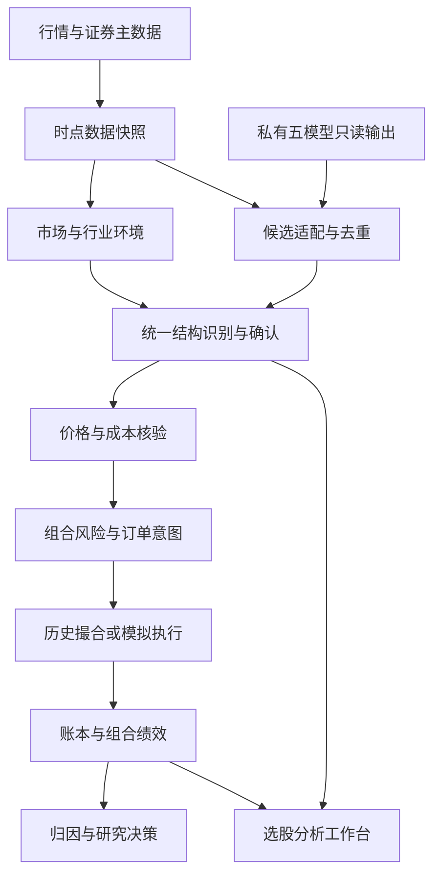

# Price Action Lab 整合重构完整 TODO 与 AI 执行任务书

版本：1.0｜编制日期：2026-10-12｜用途：交给开发 AI 分批实施，不是收益承诺或实盘买卖指令。

审阅仓库：https://github.com/RaiderYi/price-action-lab  
审阅提交：`02154d7327530f699be23017534d6157bd646f5a`，提交时间 2026-10-12 09:36:20 +0800。执行前须检查后续差异。

## 1. 核心判断与建设目标

**这个仓库具有值得保留的价格行为研究资产，但当前还不是一个已经证明具有超额收益的选股交易系统。整合的重点应是统一信号语义、建立可靠数据与成交账本、验证选股和择时的独立贡献，再逐步形成组合策略。**

现有资产包括 11 个核心 Python 文件、62 个测试文件、一个回测脚本、回测结果 JSON、整合方案，以及 1029 个知识库 Markdown 文件，其中概念页 241 个。数字来自本次提交的实际文件统计，不沿用 README 的历史口径。

现有回测 JSON 共 34 笔交易，5 只股票的策略收益减买入持有收益的算术平均约为 **-0.8681 个百分点**。这是对已有结果文件的复算，不是本次重新下载行情完成的回测，更不是组合净值层面的风险调整 alpha。

目标产品定位：**A 股选股分析与交易研究工作台**。每天能够回答：

1. 今天是否适合承担股票风险，允许多大风险预算？
2. 哪些股票值得进入候选池，优势来自什么？
3. 价格结构是否成立，何时确认，何时失效？
4. 在资金、成本、流动性与交易规则约束下，能否形成订单意图？
5. 持仓如何管理，为什么退出，真实组合表现如何？
6. 哪些模块带来增益，哪些应该删除或继续研究？

开发成功与策略成功分开验收：代码正确、可复现是必要条件；只有成本后样本外结果与前向验证支持，才能把某个策略版本提升为可用交易策略。策略检验不通过，也应交付清楚的负结果，而不能无限调参直至回测变好。

### 1.1 本任务的默认范围

| 事项 | 默认决策 | 何时调整 |
|---|---|---|
| 市场 | A 股普通股票；第一版只做多，不加杠杆 | 其他市场另建规则与实验，不混入 |
| 板块 | 第一版可执行池先限定沪深主板；创业板/科创板先研究 | 接入对应交易规则、权限和数据验收后独立放开 |
| 决策节奏 | 盘后形成次日候选；完成的 30m K 线驱动结构确认 | 盘中升级须有足够低延迟行情和历史重放能力 |
| 周期 | 30m 为入场结构周期；日线为个股/行业背景；周线后置 | 日/周线加入是新假设，必须单独消融 |
| 执行方式 | 研究回测 → paper 模拟 → 人工确认的交易计划 | 不在本任务中默认接入自动实盘下单 |
| 私有选股包 | 只读外部适配器，固定版本，禁止复制进公开仓库 | 用户明确另行授权并完成边界审查后再讨论 |
| 数据存储 | 单机文件数据集＋轻量事务账本 | 数据量和并发实际达到瓶颈再升级 |
| 产品界面 | 先 CLI 与静态/轻量报告，后分析页面 | 先有可信数据和决策记录，再做页面 |
| 收益目标 | 验证相对预注册基准的成本后增益 | 不把某个年化收益数字写成程序必须实现的承诺 |

风险参数和实验阈值均是待校准的工程建议，不代表适合用户个人资产配置。第一阶段完成能研究、能选股、能解释、能模拟的闭环。

## 2. 已核验的问题：先修这些，再讨论提高收益

标识说明：**复现**＝本次用最小程序得到结果；**源码**＝可从当前文件直接确认；**待核验**＝设计存在风险，不能当作已经发生的事实。

| 编号/优先级 | 发现与代码位置 | 影响 | 必须采取的动作 |
|---|---|---|---|
| F01 / P0 | **源码**：回测只调用 `market_analyzer.analyze_market_structure` 和 `signal_predictor.predict_signals`，没有走 strict → qualification → actionability | README 的三层架构与被回测的交易路径并不等同，现有结果不能代表严格链路 | 固定 legacy 路径；新建统一决策引擎；分别评价两条路径 |
| F02 / P0 | **复现**：`_check_h2_l2_setup` 多头分支只需近期存在一个 HL 且当前价高于该点 1% | 代理 H2 与第二次尝试的严格计数混用 | 拆开 `legacy_proxy_h2` 与 `h2_second_entry`，禁止直接改名后当作同一历史策略 |
| F03 / P0 | **复现**：`_is_breakout_entry` 配置 extreme=0.7，多头却比较 `position >= 1-extreme`，空头比较 `position <= extreme` | 收于区间 40% 的多头棒、60% 的空头棒均可能被判极端收盘 | 若定义为顶部/底部 30%，条件应分别为 ≥0.7 / ≤0.3；补边界反例 |
| F04 / P0 | **源码**：`final_flag` 文档定位反转，检测和发出方向却跟随原趋势突破 | 延续与反转混在同名信号中，归因和统计失真 | 分开末端旗形形态、顺势突破事件、失败后反转事件；未经确认不得直接反向下单 |
| F05 / P0 | **复现**：`system_price_builder` 没有 breakout/final_flag 专用 builder，空证据仍落到固定百分比 `_generic` 并返回 `success` | 无结构的价格被包装成系统事实 | 缺少必要证据返回 `insufficient_evidence`；百分比基线只能显式研究使用 |
| F06 / P0 | **源码**：回测把任何 buy prediction 下一根开盘买入，没有真正执行 `trigger_condition` | “等待反转棒/边界突破”与“已触发”混淆 | 建立 setup/armed/triggered 状态和订单意图；预测不得直接成交 |
| F07 / P0 | **源码**：止损触达后固定以 stop 成交 | 跳空、跌停、停牌、无量时可能出现虚假成交 | 加订单类型、开盘缺口、可成交量、价格限制与未成交处理 |
| F08 / P0 | **源码**：循环不处理最后一根正常持仓逻辑，末尾无条件按最后收盘平仓 | 可能忽略末棒止损/止盈，且期末强平可能绕过 T+1 | 正常处理全部可见 bar；期末默认持仓估值，强制平仓场景单独报告 |
| F09 / P0 | **源码**：`strat_ret = Σ(exit-entry)/区间起点价`；文档写“满仓单笔复利” | 实际更接近固定股数累计价差，既无复利账户，也无组合约束 | 建立现金、份额、费用、持仓与逐日 NAV；历史指标标注旧定义 |
| F10 / P0 | **源码**：行情 CSV 不在仓库，回测输入没有可复现数据快照/manifest；未见依赖清单 | 随机种子不能保证复现实验，文件集合变化会改变抽样 | 固定文件清单、时间范围、供应商、复权、校验和、环境锁定 |
| F11 / P0 | **环境＋源码**：本环境无 pytest；静态检查又发现多个测试引用仓内不存在的模块 | 无法确认 README 所述“889 通过”适用于此提交 | 恢复可安装项目；区分仓内核心与外部集成测试；禁止以大面积 skip 伪造通过 |
| F12 / P0 | **复现**：`report_signal_filter` 导入缺失的 `brooks_ontology_registry` 失败 | 报告路径不能独立使用 | 补齐自有实现或明确外部插件依赖，修改过时入口 |
| F13 / P1 | **源码**：`market_analyzer` 对 `kb_rules` 导入失败静默 fallback；回测又 `except Exception: continue` | 环境差异和错误可能悄悄改变样本及策略行为 | 明确 capability、错误分类、跳过清单；关键错误使本轮失效 |
| F14 / P1 | **源码**：预测 confidence 多为固定 0.55/0.60/0.65，regime 也存在固定分值 | 不能用作经验胜率或准确概率；排序存在同分偏置 | 分开质量分、规则置信、实证概率；排序稳定且可解释 |
| F15 / P1 | **源码**：注册表两套字典并存；当前 enabled 集合与 focus_config 一致，但 consistency 检查旧 14 类，旧注册表不含 breakout | “集合当前一致”不等于运行期唯一事实源 | 统一类型和版本；检测器、证据、价格、报告全链可达性测试 |
| F16 / P1 | **源码**：`strict_breakout_strength.py` 和 actionability 内均有突破强度实现，前者存在大棒极端收盘即 strong 的 fallback | 不同入口可能给同一结构不同判断 | 收敛为一个服务，明确突破位置与跟随确认的时间 |
| F17 / P1 | **源码/待核验**：摆点用左右窗口；关键位用全历史极值；分析全历史而预测最多 160 根 | 需要确认延迟、绝对索引与局部索引关系；不等于已经证明未来泄漏 | 记录 `formed_at/confirmed_at/available_at`；前缀一致性与截窗测试 |
| F18 / P1 | **源码**：楔形用局部极值幅度递减判断，未充分限定三推单调方向与有效间隔 | 错误极值组合可能被解释成楔形 | 三推各自绑定 bar，校验方向、间隔、幅度和确认时间 |
| F19 / P1 | **源码**：区间入场“靠近下沿”用固定 2%，与区间宽度/ATR 未统一 | 高低价和不同波动率股票被不同尺度处理 | 使用归一化位置和波动尺度，参数仅训练期选取 |
| F20 / P1 | **文档**：原整合方案称两门为“双独立证据”，以“B 胜率 +5pp / 踏空 40% / 30 笔”判定 | 两套 PA 可能高度相关；小样本和胜率不能直接证明净增益 | 做配对对照、净收益/回撤/成本/曝光分析；样本不足判 inconclusive |
| F21 / P1 | **知识库抽样**：H2 计数、孕线、超时存在多版本；概率表“70%胜率需回报≥风险才打平”与无成本二项方程不符 | RAG 可能把冲突知识与数学错误固化成规则 | 分离原文、转述、实现假设；对概率条目做数学及来源审核 |
| F22 / P1 | **外部核对**：回测报告把 688120 写为“华大九天”；上交所公告显示为“华海清科” | 至少报告证券名称错误，行情代码对应关系也应复核 | 证券主数据统一输出名称，核验文件代码和证券身份 |

F22 官方核对来源：[上交所华海清科上市公告](https://www.sse.com.cn/disclosure/announcement/listing/ipo/c/c_20220607_85637628.shtml)。这只证明名称错误，不能据此断言行情数据也错误。

### 2.1 本次最小复现的具体结果

| 输入/检查 | 当前输出 | 正确重构要求 |
|---|---|---|
| 前高 100；最后 high=107、low=97、close=101；ATR=1 | buy breakout=true，收盘位置 40% | 不满足“顶部 30%” |
| 前低 99；最后 high=102、low=92、close=98；ATR=1 | sell breakout=true，收盘位置 60% | 不满足“底部 30%” |
| Swing 序列 HH100、HL99、HH101；close101 | H2=true | 只证实代理条件，不能声称严格第二次计数 |
| breakout、long、current_price100、空证据 | stop93、tp106、status=success | 应缺证据，禁止进入结构型订单链 |
| final_flag、long、current_price100、空证据 | 同上 | 同上 |
| `import report_signal_filter` | ModuleNotFoundError | 核心安装环境必须闭环 |

独立缺失模块包括 `rule_guardrail`、`system_structure_builder`、`strict_paper_tracker`、`evidence_verifier`、`candidate_pool`、`kb_rules`、`wiki_assembler` 等。本次不擅自恢复来自私有项目的源码，也不将这些缺口描述成已经修复。

**关于未来函数的精确判断：**当前回测对每个时间点传入历史前缀，左右窗口摆点在这种用法下可以是“延迟确认”，并不自动构成未来泄漏。但若以后全量预计算并按摆点发生时间回填，或合并尚未确认的高周期 bar，就可能泄漏；必须将可用时间写入数据协议。

## 3. 目标架构：单一决策内核，外部候选可替换



第一版采用模块化单体。数据、信号、撮合、账本、报告分别有清晰接口，但不为了形式拆成微服务，不先建设复杂消息队列、向量库和多 Agent 调度。

### 3.1 整合原则

1. **选股回答“看谁”，结构回答“看到了什么”，组合回答“分多少资金”，执行回答“是否成交”。** 四种职责不得被一个 EV 分数代替。
2. 私有五模型作为只读候选来源。通过独立进程产物/JSON 边界接入，不直接导入其内部 `kline_unified_fetcher`，避免冻结快照与核心代码耦合。
3. 没有私有包时，公开仓库仍能用历史股票池、透明基线选股器和合成夹具运行；真实五模型的增益结论必须标记为尚未验证。
4. 现有三层 strict 实现重点针对 H1/H2/L1/L2；不能假定已经覆盖所有形态。其他形态可采用同样的“识别—资格—可执行性”接口，但各自需要独立检测证据。
5. LLM 只负责解释和检索，不生成价格、概率、仓位或不可复算的交易事实；无 LLM 模式必须可完成同一交易决策。
6. 硬门只用于客观不可交易与关键缺证据。环境、强度等经济假设既要支持硬过滤，也要支持排序加分实验，避免多门叠加杀死全部样本。
7. 决策配置、数据版本、知识规则与概率校准版本均被冻结并可回放；研究修改不能覆盖已运行的策略身份。

### 3.2 建议目录与现有文件迁移

目录是目标设计，当前仓库尚未具备这些模块。使用 `pyproject.toml` 创建可安装包，以下以 `pal` 为命名示例。

| 目标路径 | 职责 | 现有资产如何处理 |
|---|---|---|
| `src/pal/domain/` | 数据对象、枚举、错误、标识符 | 新建；消除自由字符串和任意 dict 的关键歧义 |
| `src/pal/config/` | 配置加载、验证、版本指纹 | 整理 focus_config，成熟度与生产启用分开 |
| `src/pal/data/` | 行情、时点数据、主数据、交易日历 | 新建；供应商适配隔离 |
| `src/pal/selection/` | 五模型桥接、透明基线、候选排序 | JSON 适配，保留 source 与原始语义 |
| `src/pal/context/` | 市场/行业/个股环境和因果摆点 | 改造 market_analyzer |
| `src/pal/signals/` | 结构状态机、资格、冲突与证据 | 迁移 bar_counting 与 strict 三层；旧 predictor 留在 legacy |
| `src/pal/pricing/` | 结构入场、止损、目标与成本后 RR | 改造 system_price_builder，补全类型覆盖 |
| `src/pal/portfolio/` | 仓位、现金、相关性、风险预算 | 新建 |
| `src/pal/execution/` | 订单状态机、市场规则、撮合 | 历史和 paper 共用；真实券商适配后置 |
| `src/pal/research/` | 实验、切分、指标、归因、校准 | 旧 random5 脚本转为明确标记的 legacy runner |
| `src/pal/ledger/` | 事件、订单、成交、持仓、净值 | 新建，不依赖仓外 ledger 才能启动 |
| `src/pal/reporting/` | JSON、Markdown、页面视图 | 重建报告过滤；从统一决策对象渲染 |
| `src/pal/knowledge/` | 规则证据索引、冲突、来源版本 | 知识 Markdown 保留原始记录，新增审核后的 rule cards |
| `tests/{unit,integration,causality,accounting,fixtures}/` | 分层验收 | 迁移有效测试，缺依赖的测试逐项处理 |
| `configs/experiments/`、`docs/adr/` | 冻结配置与架构决策 | 保存设计更改的原因 |

默认存储可用 Parquet 管时序事实、SQLite 管事务账本，研究查询视需要采用 DuckDB。具体依赖版本由执行 AI 在实施时检查官方文档并锁定，不在这里虚构版本兼容性。

## 4. 必须先统一的数据与决策协议

| 对象 | 必填核心字段 | 关键约束 |
|---|---|---|
| `RunManifest` | run_id、git_sha、config_hash、data_snapshot_id、rule_version、calendar_version、created_at | 同一输入与版本生成同一确定性决策；运行耗时可不同 |
| `SecurityMaster` | instrument_id、exchange、code、board、name、list/delist_date、effective_from/to | code 使用字符串；名称/板块/ST/行业均有历史生效区间 |
| `Bar` | instrument_id、timeframe、bar_start/end、available_at、OHLCV、amount、adjustment_basis、source、is_final | Asia/Shanghai；单位明确；交易时段正确；完整性可校验 |
| `Candidate` | candidate_id、instrument_id、asof、available_at、eligible_from、source_models、source_version、source_bucket | 候选生成时刻早于使用时刻；多来源不是重复持仓 |
| `SourceEstimate` | source_wr、source_ev、source_method、probability_status、source_price/stop/target | 原始先验保留且不可伪装成实证概率 |
| `ContextSnapshot` | market/sector/stock_regime、feature_asof、quality_score、rule_version、reason_codes | `unknown` 不能等同 `range`；质量分不叫胜率 |
| `StructureEvidence` | evidence_id、kind、bar_ids、formed_at、confirmed_at、available_at、price_basis、rule_id | 摆点与来源 bar 可复算；形成和确认时间分开 |
| `SignalEvent` | signal_id、setup_id、family、implementation、direction、state、signal_at、confirmed_at、expires_at、evidence_ids | raw / qualified / armed / triggered / rejected / expired 不混用 |
| `TradePlan` | plan_id、signal_id、entry_policy、entry_zone、stop、targets、invalidation、expiry、price_status | target 缺证据不可伪造；交易计划不等于成交 |
| `RiskDecision` | allow、reason_codes、max_qty、risk_budget、exposure_before/after、cash_available | 风险按组合账户算，不对每只股票分别假设满仓 |
| `OrderIntent` | order_id、plan_id、side、order_type、qty、limit/stop_price、valid_from/to | earliest_execution_at 晚于信息可用时刻；拒绝理由有编号 |
| `Fill` | fill_id、order_id、timestamp、qty、raw_price、commission、tax、fees、slippage、fill_model | 不允许用复权分析价直接入账；费用不可重复计入 |
| `PositionLot` | lot_id、instrument_id、qty、available_qty、cost、acquired_at、sellable_from | 分批买入分批记录可卖量；卖出信号不能绕过锁定 |
| `ExperimentResult` | experiment_id、variant、split、metrics、confidence_intervals、status、limitations | PASS / FAIL / INCONCLUSIVE 分开，缺数据不算零收益 |

关键附加协议：

- `buy/sell`、`long/short`、`up/down` 不再相互代替：方向描述、交易动作和持仓方向分别枚举。第一版 L2 可作风险提示或符合规则的持仓退出输入，不能开空仓。
- 两套系统使用不同周期、复权和止损结构时，不直接比较数字判断“冲突”。先映射时间和价格坐标；A 原方案保留原价格，B 新方案记录自有价格及规则。
- 未完成日/周 K 默认只作标记清楚的辅助信息，不进入基线交易决策。若要保持私有包原先“临时 K 同权重”的行为，必须记录当时快照并独立验证，不用最终完成 K 倒填。
- 信号状态与订单状态各有状态机：`TRIGGERED` 不代表 `FILLED`，`EXPIRED` 不抹除既有成交和持仓；部分成交、撤单、拒单均需记录。
- 桥接 `TRADE_PLAN_STRUCTURED_V1` 只从明确的 JSON 标记块读取，拒绝缺字段、未知版本、时间倒置和单位不明；不靠解析 Markdown 表格获得交易事实。

## 5. 超额收益的检验方法：在开发前冻结

### 5.1 先明确超额相对什么

至少同时提供以下对照，但预先指定一个主检验，避免事后挑最好看的指标：

| 对照 | 解决的问题 | 统一要求 |
|---|---|---|
| 宽基总收益基准 | 是否只是跟随市场上涨 | 同起止时间、总收益口径；若只有价格指数明确偏差 |
| 可投资股票池简单组合 | 选中的股票是否优于可交易集合 | 历史时点股票池、固定调仓规则、相同成本与资金约束 |
| 同一候选池简单持有 | Focus 的择时是否增加价值 | 相同候选生成时点和机会集，基准入场/退出预注册 |
| 行业/规模匹配对照 | 是否只是偏向强行业、小盘或高波动 | 使用时点行业/规模，不能采用当前分类回填 |
| 现金及低曝光对照 | 少交易带来的回撤改善是否被误称为 alpha | 同期净值、平均仓位、Beta 与现金收益假设明确 |

“5 只股票各自收益差再平均”只可作为描述统计。正式组合超额必须由同一资本账户、同一时间轴和明确基准计算。

### 5.2 拆分整合的增益，而不是只跑 A/B

分两层实验，避免实验数量无边界膨胀。先测候选选择，再在冻结候选上测结构门。

| 变体 | 组成 | 主要回答 |
|---|---|---|
| U0 | 历史可交易股票池＋透明固定持有/调仓基线 | 基础市场收益 |
| S0 | 透明强度/趋势选股器＋相同固定交易规则 | 简单选股是否已经有效 |
| S1 | 私有五模型候选＋与 S0 相同交易规则 | 五模型候选是否有独立增益；私有输入缺失时不运行 |
| A-original | 完整保留五模型原始决策/价格/执行定义 | 旧系统实际基线；若定义或输入不全则标不可复现 |
| B0 | 冻结候选＋统一基础执行，不加 Focus 门 | Focus 对照基线 |
| B1 | B0＋仅 regime 门 | 环境识别贡献 |
| B2 | B0＋仅严格结构门 | 结构贡献 |
| B3 | B0＋regime＋严格结构门 | 双门交互是否有正贡献 |
| B4 | B3＋新价格/退出/组合规则 | 完整产品效果；不把总效果都归功于过滤器 |

说明：S1 评估使用“全候选准入池”还是“原 EV 已过滤池”必须在实验名中写明。如果只有 EV 过滤后的结果，不能声称测到了整个候选生成器；被先验门剔除的股票已不可见。

纯门控实验 B0—B3：对都接受的相同机会保持相同入场/退出与仓位规则。B 没有接受的机会保留反事实结果，但不能把 A 的成交伪装成 B 的成交。完整组合实验允许资金重新配置，其影响必须单独归因。

### 5.3 指标、公式及概率

- 账户净值：`NAV_t = cash_t + Σ(qty_i,t × mark_price_i,t)`；企业行动、费用、应收股息与现金转移按明确会计政策处理。
- 日收益：无外部资金流时 `r_t = NAV_t/NAV_(t-1)-1`。有资金流时先剔除流量影响。
- 累计收益差：`(NAV_T/NAV_0-1) - (Benchmark_T/Benchmark_0-1)`，单位百分点。
- 相对财富：`(NAV_T/NAV_0)/(Benchmark_T/Benchmark_0)-1`，与收益差分别命名，不能混称同一指标。
- 信息比率：用日超额收益的均值/标准差乘年度交易日数平方根；无波动或样本不足时返回 NA。
- 最大回撤、年化波动、尾部损失、换手、平均持仓、行业集中、成交率、成本占毛收益、容量、收益集中度一并报告。
- `R_net = 单笔净盈亏 / 入场时初始风险金额`。初始风险不能随移动止损更新；跳空可能导致损失超过 1R。
- 一般交易期望：`E[R_net] = Σ P(outcome=k) × E[R_net | outcome=k]`。包含止盈、止损、超时、部分退出等真实结果。
- 简化二项且亏损固定 1R 时才可用 `p×b - (1-p) - c`。实际有超时/缺口时不能只用目标 RR 代替实现盈亏。
- 无成本二项盈亏平衡 `b=(1-p)/p`。p=70% 时 b≈0.4286；这说明知识库相关“至少 1:1 才打平”不能直接作为数学规则。
- 未校准时 `p_win=null`，保留 `heuristic_score`，不输出“预计胜率65%”；不能为了让 EV 可计算而填常量概率。
- 若进行概率校准，事件定义必须包括退出策略、期限、费用、T+1 和可成交性；只用训练窗口内已完成标签，使用时间外验证并报告校准误差/置信区间。

### 5.4 样本外与防过拟合

1. 原 34 笔和已反复查看的 2026 年样本属于开发数据，不再充当未见测试集。
2. 目标历史覆盖多个市场环境，建议以可负担的多年日线＋足够长的可靠 30m 数据起步；不足时缩小结论范围，不生成虚构长历史。
3. 研究、验证、最终保留段按时间划分；滚动训练/验证时阈值和校准只由过去决定。现有“逐 bar 历史前缀回放”不等于完成了训练—验证的 walk-forward。
4. 标签跨越切分边界的样本从训练集清除，按持有期和事件重叠设置隔离。允许测试开端使用之前已知历史作指标 warm-up，但不能将测试收益标签用于训练。
5. 同一日、同一行业的股票以及重叠持仓高度相关；置信区间按日期块/事件簇抽样，保留 A/B 配对关系，不能将每笔交易视作独立同分布。
6. 记录每次试验，包括失败和废弃参数；先小范围合理假设，再做参数邻域稳健性，避免数千次搜索后只报告冠军。
7. 保留多重尝试修正和过拟合评估扩展；主结果同时检查经济增益、统计不确定性、成本压力和可执行性。
8. 测试集一旦用于改规则，就转为开发集；下一结论需要新的保留段或未来数据。不能每周重看同一保留段再称独立检验。

### 5.5 分级退出条件

| 关口 | 条件 | 不满足时 |
|---|---|---|
| G0 工程正确 | 因果性、账本、规则、依赖核心验收全部通过 | 停止收益结论，先修复 |
| G1 研究候选 | 成本后样本外主指标达到预注册经济门槛；参数邻域和主要环境无明显崩溃 | FAIL 或 INCONCLUSIVE，不提升 |
| G2 统计可信 | 主指标区间估计支持正增益，已考虑重复尝试与相关性；有效样本足够 | 扩充数据/前向观察，不拿“30笔”替代功效评估 |
| G3 可运营 | 固定版本 paper 连续运行、信号可回放、订单/账本可核对 | 修复后重新积累受影响的证据 |
| G4 小额实盘资格 | 用户另行确认资本、权限、最大亏损和执行边界 | 保持模拟，不自动开户或下单 |

建议将 8—12 周 paper 当作运行与执行验证窗口，不能保证覆盖足够市场周期。最低经济门槛、置信水平、最大容忍回撤和计划样本量写入实验配置；未填完整时不输出正式 PASS。可先以成本后平均日超额为主检验、95% 区间为报告默认，但应结合有效样本和可承受的数据周期预注册，不能只追求显著性。

原方案“8周或60笔、B胜率提升不足5pp就否定”的判据应替换：胜率下降而单笔收益提高可能有效；胜率提高但换手成本、尾部亏损或资金闲置增加也可能无效。

## 6. 完整实施 TODO：80 个任务，按依赖推进

任务状态初始均为未执行。阶段不等于 Git 一次大提交；每个任务形成可审查的小改动。每个阶段的依赖对阶段内所有任务生效；括号中的 F 编号对应前述问题。

优先级：P0＝影响正确性/可运行性，先做；P1＝最小研究交易闭环必需；P2＝闭环后产品与运营增强。每项产物必须附命令、输入版本、实际输出和限制，禁止用“理论上已完成”验收。

### S0 / P0：冻结证据、恢复可运行基础

前置：读取当前提交及仓内实际存在的 AGENTS.md；若仓库已变化，先生成本审阅提交与新 HEAD 的差异。

| 完成 | ID | 任务 | 交付物/代码位置 | 验收标准 |
|---|---|---|---|---|
| [ ] | S0-01 | 冻结 legacy 实验，不覆盖旧结果；记录原脚本、JSON、文档 hash（F01/F09） | `docs/audit/baseline.md`、legacy manifest | 可说明每个旧收益指标的计算方式；旧文件保留；新实验输出独立目录 |
| [ ] | S0-02 | 建立依赖/入口/缺文件地图，区分自有代码、可选插件和私有依赖（F10—13） | `docs/audit/dependency-map.md` | 11 源文件及 62 测试文件逐一归类；缺模块有明确处置，不静默跳过 |
| [ ] | S0-03 | 建立可安装包、依赖锁定、开发依赖与 CLI 基础 | `pyproject.toml`、锁文件、`src/pal/cli.py` | 新环境安装后可从仓库外运行 `pal --help`；不依赖 cwd 或手工改 sys.path |
| [ ] | S0-04 | 恢复测试收集；仓外集成测试单列，核心测试缺依赖必须失败（F11/F12） | 测试迁移清单、CI 配置 | 报告 collected/passed/failed/skipped 及原因；公开核心用例可独立运行；不声称延续“889通过” |
| [ ] | S0-05 | 加入已复现错误的最小回归夹具，再修正突破阈值（F03） | `tests/unit/test_breakout_extremes.py` | 0.4 多头、0.6 空头应拒绝；0.7/0.3 边界符合定义；不修改 fixture 来掩盖错误 |
| [ ] | S0-06 | 取消关键路径静默异常，记录错误与降级能力（F13） | `domain/errors.py`、run status | 缺行情、坏数据、代码异常可区分；关键错误使 run=invalid；失败不是 no_signal |
| [ ] | S0-07 | 更新 README、回测报告名称/收益口径和真实性声明（F09/F22） | README、勘误记录 | 688120 名称纠正并核验数据身份；旧结论加适用范围；不删除负结果 |
| [ ] | S0-08 | 检查公开仓库输入输出边界与许可 | `.gitignore`、合成公开夹具、提交检查 | 私有分享包及产物不入库；行情许可单独记录；知识库不被 MIT 自动重新授权 |

阶段出口：干净环境可启动、核心测试可收集、错误可解释，历史证据冻结。缺少私有包不能阻断公开核心开发。

### S1 / P0：统一领域对象、规则与配置

前置：S0；可先做对象定义，再迁移模块。

| 完成 | ID | 任务 | 交付物/代码位置 | 验收标准 |
|---|---|---|---|---|
| [ ] | S1-01 | 实现第4节领域模型与 JSON Schema | `domain/models.py`、`schemas/` | 非法时间、负价格、未知方向/状态、无版本输入被明确拒绝 |
| [ ] | S1-02 | 注册表合并为唯一读取接口，分开 family、implementation、maturity、enabled（F15） | `signals/registry.py` | 每个启用信号都有检测、证据、资格、定价、报告映射；未知类型默认拒绝 |
| [ ] | S1-03 | 严格信号与旧代理信号使用不同 ID（F01/F02） | `signals/legacy/`、alias migration | 历史 proxy 结果仍可复现；不能被新 strict 统计合并 |
| [ ] | S1-04 | 所有阈值、交易规则、研究配置有版本和 hash | `config/`、`configs/experiments/` | 同一版本可复跑；运行中改配置不得改变已发信号；禁止散落魔法常量 |
| [ ] | S1-05 | 建立知识规则卡：定义、来源、公式、前提、反例、工程偏离（F21） | `knowledge/rules/`、冲突清单 | H2孕线/计数/超时、final_flag、概率条目先完成审核；未审核知识不可自动转生产规则 |
| [ ] | S1-06 | 将质量分与概率分离（F14/F20） | `domain/estimates.py`、报告字段 | `heuristic_score` 不输出为胜率；未校准 `p_win=null`；来源先验始终有标记 |
| [ ] | S1-07 | 统一 run/candidate/setup/signal/plan/order/fill ID | `domain/identity.py` | 重跑不重复创建订单；同票不同 setup 可区分；审计链可追到 bar |
| [ ] | S1-08 | 实现规范决策快照及规则解释协议 | `domain/decision.py` | 每次 accept/reject/wait 都有 rule_id、evidence_id、reason_code；序列化可重放 |

阶段出口：没有两个模块分别定义“什么是 H2”“什么是可交易”；配置变更与策略版本变更可追踪。

### S2 / P0：建设时点正确的市场数据层

前置：S1。历史数据取得是关键外部依赖；可用公开合成夹具做工程，但不能拿合成行情验证收益。

| 完成 | ID | 任务 | 交付物/代码位置 | 验收标准 |
|---|---|---|---|---|
| [ ] | S2-01 | 盘点日线/30m/企业行动/退市/ST/行业历史数据可获得性与成本 | 数据能力矩阵、缺口清单 | 明确真实覆盖期、粒度、复权、许可、获取费用；短缓存不能伪装多年历史 |
| [ ] | S2-02 | 建立证券主数据与历史可交易股票池（F22） | `data/security_master.py`、`universe.py` | 退市样本和历史风险状态可保留；不以今天成分股回测过去；未知历史状态隔离 |
| [ ] | S2-03 | 实现交易日历、正常/特殊交易时段和 30m bar 对齐 | `data/calendar.py`、`resample.py` | 午休、节假日、特殊停市和集合竞价边界处理有 fixture；标签时间与 bar 完成时间不混淆 |
| [ ] | S2-04 | 统一行情适配器和质量校验，数据源切换不静默拼接 | `data/providers/`、quality report | OHLC关系、重复、缺失、异常跳变、成交单位检查；切源差异有事件与隔离机制 |
| [ ] | S2-05 | 分开原始可成交价、研究调整价与企业行动 | `data/adjustments.py`、`corporate_actions.py` | 除权前后仓位/现金可对账；研究点位可转换到当时 raw 坐标；不能使用未来企业行动信息 |
| [ ] | S2-06 | 实现 available_at 时点查询、多周期 as-of join（F17） | `data/asof.py` | 盘中拿不到当日日线最终 high/close；未完成周线不可倒填；供应商延迟被考虑 |
| [ ] | S2-07 | 冻结数据快照和 manifest（F10） | `data/snapshots.py` | 时间范围、文件列表、数据版本、hash、adjustment_basis、质量结果完整；同 seed 同输入可复现 |
| [ ] | S2-08 | 建立数据新鲜度和失败闭锁 | `data/health.py`、freshness fixture | 昨日缓存/缺末棒/新源错误不能标“今日完成”；阻断新订单，同时按有效行情管理已有持仓 |

阶段出口：每条信息都能回答“什么时候发生、什么时候系统能知道”；没有数据的能力明确不可用。

### S3 / P1：打通选股来源与排序，建立没有私有包也能运行的基线

前置：S1、S2。

| 完成 | ID | 任务 | 交付物/代码位置 | 验收标准 |
|---|---|---|---|---|
| [ ] | S3-01 | 创建统一 CandidateProvider 协议与能力声明 | `selection/providers/base.py` | 外部五模型、静态研究池、透明基线均产同一对象；缺提供者明确 disabled |
| [ ] | S3-02 | 实现 STRUCTURED_V1 JSON 块解析和版本适配 | `selection/providers/five_model.py` | 缺/重复 JSON块、非法 JSON、版本未知、数值缺失、股票前导零有测试；不解析 Markdown 表格 |
| [ ] | S3-03 | 私有环境核对真实产物与桥接结果 | 本地接口核验表、私有运行日志 | 票数、档位、来源、EV/WR、价格/止损/目标逐项一致；真实样例不提交公开仓库 |
| [ ] | S3-04 | 候选全量准入与原 EV 通过池分开存储 | admission snapshot、source estimates | 能分析被源门淘汰的范围；只有过滤后产物时声明覆盖限制；无历史池不补造历史 |
| [ ] | S3-05 | 同票多模型去重并保留支持/冲突关系 | `selection/merge.py` | 一个证券不因五个来源获得五份仓位；重复来源不自动视为独立证据 |
| [ ] | S3-06 | 实现透明基线选股：流动性＋日线相对强度/趋势 | `selection/baselines.py` | 从完整可交易池排名；窗口、调仓频率、排除条件预先固定；不使用当期未来收益 |
| [ ] | S3-07 | 候选横截面排序与 Top-K 评估 | `selection/ranking.py` | 分数可分解，因子尺度/缺失处理一致；同分确定性；K不依据测试结果反复挑选 |
| [ ] | S3-08 | 候选有效期与隔夜重验证 | candidate lifecycle | 盘后候选最早次日生效；次日停牌/风险事件/超出入场区作废或等待，不能使用昨日价直接成交 |

阶段出口：稳定输出“为什么选中、来自哪里、何时可用”的候选清单。五模型不可得时只影响该 provider 的实证研究，不阻断其余工作。

### S4 / P0—P1：统一结构引擎与交易计划

前置：S1、S2；与候选来源解耦，用历史股票池即可验收。

| 完成 | ID | 任务 | 交付物/代码位置 | 验收标准 |
|---|---|---|---|---|
| [ ] | S4-01 | 因果摆点、结构有效期、绝对 bar ID 与确认延迟（F17） | `context/swings.py` | 增加未来数据不改变过去已发决策；尚未确认摆点不能用；160根截窗不混索引 |
| [ ] | S4-02 | 市场/行业/个股 regime 分开，unknown 不默认区间 | `context/regime.py` | 输出特征和规则原因；切换有最短确认/滞后政策；不能用事后牛熊标签当输入 |
| [ ] | S4-03 | 将 strict H2 全链路接入统一引擎（F01/F02） | `signals/h2.py`、`engine.py` | 计数→资格→actionability→触发全部留痕；一个 HL 反弹不能伪装二次计数 |
| [ ] | S4-04 | 统一突破强度、突破位、跟随确认和假突破定义（F03/F16） | `signals/breakout.py` | 仅大棒无越界不能强突破；需要跟随时最早下一棒确认；所有入口同判断 |
| [ ] | S4-05 | 拆分 wedge/final_flag/tr_fade 形态与触发；初期默认 research（F04/F18/F19） | 三类信号规则卡及实现 | 三推单调和间隔、旗形失败后反转、区间归一化位置均有正反例；不凭命名放行 |
| [ ] | S4-06 | 建立统一 setup 状态机、去重、失效、冷却和冲突规则（F06） | `signals/lifecycle.py` | WAIT 不成交；过期不复活；同一结构不每根 bar 重复开仓；多空冲突有明确输出 |
| [ ] | S4-07 | 重构系统价格服务，清除隐式百分比成功兜底（F05） | `pricing/structure_prices.py` | 每种启用入场信号有结构 stop/target；缺证据不可 TRADE_READY；多头 stop<entry<target；成本后空间复核 |
| [ ] | S4-08 | 决策内核提供相同的 replay/scan/paper 入口 | `engine.evaluate(asof, snapshot, candidates, config)` | 相同已知事实的历史/模拟决策一致；业务内核不读取系统当前时间；规则启停效果可观测 |

阶段出口：第一版先让 H2 与 breakout 正确可测，其他结构保留研究能力，按独立样本外证据逐个晋级。六个旧键不等于六个必须同时上线的交易策略。

### S5 / P0：真实撮合与账户账本

前置：S1、S2、S4。收益结论必须等本阶段通过。

| 完成 | ID | 任务 | 交付物/代码位置 | 验收标准 |
|---|---|---|---|---|
| [ ] | S5-01 | 实现按交易所/板块/生效日版本化的交易规则和费用 | `execution/market_rules.py`、rules manifest | 包括交收可卖、价格限制、申报数量、最小价位、委托类型和税费；保存官方来源及生效日 |
| [ ] | S5-02 | 订单状态机与事件时钟：意图、受理、部分成交、成交、撤单、拒绝 | `execution/orders.py` | 触价≠成交；形成/确认/可执行时间严格递增；不能先用 bar high 确认再填同 bar open |
| [ ] | S5-03 | 撮合 stop/limit/market 模型，处理跳空与 bar 路径不确定（F07） | `execution/fill_models.py` | 多头止损遇可成交开盘低于 stop 不能填 stop；同bar双触达给保守结果及敏感性；订单类型明确 |
| [ ] | S5-04 | 涨跌停、停牌、成交量参与率、部分成交与资金锁定 | liquidity/limit fixtures | 封板/无量不能假设成交；跌停无法卖出时风险继续存在；已挂订单占用资金不超额 |
| [ ] | S5-05 | 分批持仓及 T+1 可卖量（F08） | `ledger/positions.py` | 当日新增不能借旧仓可卖额度全部退出；周末/节假日按交易日；库存始终非负 |
| [ ] | S5-06 | 现金、费用、税、分红送转、NAV 与逐笔风险收益账本（F09） | `ledger/accounting.py` | 手工微型案例逐项核对，现金守恒；成本不双计；R以初始风险金额计算 |
| [ ] | S5-07 | 修复最后 bar、超时退出与期末未平仓估值（F08） | `research/replay.py` | 最后bar正常处理；默认估值不虚构成交；强平不绕过可交易性；未平仓盈亏单列 |
| [ ] | S5-08 | 新回测引擎用统一决策与撮合，对旧结果做差异分解 | legacy-vs-corrected report | 分别报告规则修复、信号替换、价格模型、费用造成的变化；不将所有差异归于 regime |

阶段出口：合成会计和成交边界案例全部一致；真实行情结果可逐笔追到资金与订单。30m OHLC 的队列和路径不可知部分须明确假设，而非声称精确重建交易所成交。

### S6 / P1：仓位、持仓管理与风险预算

前置：S3—S5。默认参数只用于模拟研究，在未获得个人资本与风险授权前不映射真实账户。

| 完成 | ID | 任务 | 交付物/代码位置 | 验收标准 |
|---|---|---|---|---|
| [ ] | S6-01 | 风险金额定仓：风险预算、止损距离、现金与申报数量共同限制 | `portfolio/sizing.py` | qty受风险预算和资金双重上限；含预估费用；极窄止损不能放大为不合理满仓 |
| [ ] | S6-02 | 单票、行业、总仓位、最大持仓数与相关性限制 | `portfolio/constraints.py` | 同行业拥挤/高度相关票不能获得看似分散的满额风险；拒绝理由可解释 |
| [ ] | S6-03 | 加入跳空压力损失预算，而不只看 stop 风险 | stress risk report | T+1、无法卖出场景可超过初始R；预算考虑相关缺口，止损价不被当作最大亏损保证 |
| [ ] | S6-04 | 定义退出政策：结构失效、风险退出、止盈、超时、移动止损 | `portfolio/exit_policy.py` | 优先级固定；只用已知数据更新；新止损下一个合法执行时点生效；部分退出先后可回放 |
| [ ] | S6-05 | 定义新仓、加仓、减仓、再入场和冲突排序 | allocation policy | 第一版默认不摊平加仓；同票不同来源不重复配资；再入场需新 setup 或明示规则 |
| [ ] | S6-06 | 组合回撤/单日亏损/数据故障停开仓与恢复机制 | `portfolio/circuit_breaker.py` | 停开仓不冻结已有风险管理；恢复有状态和依据；手工覆盖记录独立标签 |
| [ ] | S6-07 | 资金容量与滑点压力场景 | capacity report | 不同模拟资本、参与率和2倍成本输出结果；容量以可交易量约束，不能线性无限外推 |
| [ ] | S6-08 | 建立模拟默认配置与敏感性组 | `configs/paper_default.yaml` | 例：初始模拟资金100万元、单笔风险0.25%、单票≤10%、行业≤25%、总仓位≤80%、最多10只；全部为待验证起点，且冲突取更严格条件 |

阶段出口：选股结果能变成资金约束下的组合，允许现金和空仓，不能为了展示“每日机会”强制买入。

### S7 / P1：收益验证、消融与概率校准

前置：S5、S6；只有上述工程关口通过后才解读收益。

| 完成 | ID | 任务 | 交付物/代码位置 | 验收标准 |
|---|---|---|---|---|
| [ ] | S7-01 | 冻结研究计划、主基准、最小经济增益、样本方案、失败条件 | `configs/experiments/preregistered.yaml` | 运行前有版本；阈值未填完整不得自动 PASS；所有试验有编号 |
| [ ] | S7-02 | 实现时间切分、滚动验证、标签 purge/隔离与保留集 | `research/splits.py` | 训练标签不穿越验证时间；高周期与候选可用时间纳入因果测试；保留集读取有记录 |
| [ ] | S7-03 | 跑 U0/S0/S1 与 A-original/B0—B4 分层对照 | `research/experiments.py` | 使用同一快照/成本/资本时间轴；输入缺失标 blocked；不省略效果不好的变体 |
| [ ] | S7-04 | 输出组合绩效、滚动超额、成本与曝光归因 | `research/metrics.py` | 不能仅凭胜率或ΣR判定；NAV/现金/仓位和基准对齐；小样本不机械年化 |
| [ ] | S7-05 | 对接受/拒绝机会做反事实分析与配对区间估计 | `research/attribution.py` | 相同退出定义下比较机会；记录过滤损失的赢家和避免的输家；考虑资金再配置成本 |
| [ ] | S7-06 | 稳健性：成本、参数邻域、时间段、行业/市值、去除贡献最大样本 | robustness report | 结果不完全依赖个别股票/年份/尖锐参数；输出不确定性；失败不被删除 |
| [ ] | S7-07 | 样本允许时训练/校准条件概率与净期望，否则保持分数制 | `research/calibration.py` | 只用训练期已完结结果；Brier/校准图等时间外评价；罕见形态收缩或无概率，不借知识库常数补齐 |
| [ ] | S7-08 | 生成 PASS/FAIL/INCONCLUSIVE 研究裁决 | `research/release_gate.py`、research report | 对应G0—G2；原8周/30笔/胜率提升条件不再充当证据充分性；版本失效可回退 |

阶段出口：能回答“收益来自哪里、相对什么、扣多少成本、在哪些样本不成立”。若没有超额，交付可用研究平台和负结果；下一轮只改一个有根据的假设。

### S8 / P1—P2：形成用户可用的选股分析产品

前置：S3—S7；界面可先用合成数据开发，但必须清楚标示样例，不能展示伪实盘收益。

| 完成 | ID | 任务 | 交付物/代码位置 | 验收标准 |
|---|---|---|---|---|
| [ ] | S8-01 | CLI 一键任务：doctor、ingest、scan、backtest、paper、report | `cli.py` 与运行说明 | 参数、日期、配置明确；失败返回非零；支持从任意目录启动 |
| [ ] | S8-02 | 每日选股表：准入/待触发/观察/拒绝及原因 | JSON＋Markdown＋可排序视图 | 包含全部可执行候选；展示层Top-K不反向裁掉研究日志；盘后文案为“次日计划” |
| [ ] | S8-03 | 个股详情：K线、结构、确认时刻、价格、来源、反证和历史相似结果 | individual analysis page | 点任何结构能追到bar；概率不足显示未知；旧数据水印明显 |
| [ ] | S8-04 | 持仓看板：成本、可卖量、风险、退出触发、现金与集中度 | portfolio view | 与账本一致；T+1被锁定和无法成交需可见；已触发风险不能显示已止损 |
| [ ] | S8-05 | 研究看板：基准、净值、回撤、消融、成本、过滤漏斗 | research view | 同期同口径；同时显示失败/未完成实验；不隐藏现金和费用 |
| [ ] | S8-06 | 可选 LLM 解释，从决策事实渲染并做数值一致性校验 | `reporting/explainer.py` | 关LLM不影响决策；不能改 stop/target/p/qty；无可执行计划不得输出无条件买入命令 |
| [ ] | S8-07 | 标准导出与用户手工决策记录 | CSV/JSON/Markdown、override log | 导出有schema/版本；手工改价/跳过/追加标为人工轨，不污染系统策略回测 |
| [ ] | S8-08 | 场景验收：无机会、半数数据失败、冲突信号、隔夜跳空、持仓卖不出 | 用户验收记录 | 每个场景清楚说明状态、原因和下一次检查条件；正常空仓不是系统故障 |

阶段出口：用户能够实际使用“选股—解释—计划—持仓—复盘”流程，而不是仅阅读一份泛化行情文章。

### S9 / P1—P2：前向运行、审计与版本发布

前置：S5—S8；可提前记录原始数据快照，策略验证必须使用冻结版本。

| 完成 | ID | 任务 | 交付物/代码位置 | 验收标准 |
|---|---|---|---|---|
| [ ] | S9-01 | 部署交易日调度、任务锁、重试与幂等 | scheduler、runbook | 重启/补跑不重复发单或记账；非交易日不生成假交易日数据 |
| [ ] | S9-02 | 连续纸面运行 A/B，使用各自资金账户和真实可得时刻 | paper ledgers | 一笔未成交不能写成收益；输入延迟纳入；A/B不同机会不强行同价 |
| [ ] | S9-03 | 每日对账和差异诊断 | daily reconciliation | signals/orders/fills/positions/NAV链条一致；未成交、部分成交、企业行动差异可解释 |
| [ ] | S9-04 | 监控数据、候选率、信号率、成交率、滑点、环境分布与收益漂移 | health dashboard、事件日志 | 明确报警阈值和处理动作；不足样本只标不确定；不自动调参追涨 |
| [ ] | S9-05 | 版本晋级、灰度、回滚及实验隔离 | release manifest、rollback procedure | 新旧版本独立记账；回滚不删除已发生订单/成交；生产启用需通过对应G关口 |
| [ ] | S9-06 | 备份、恢复、故障演练与敏感产物检查 | recovery report | 断电/账本恢复可继续；密钥/私有产物不进入仓库或公开报告 |
| [ ] | S9-07 | 周/月复盘固定模板，分解系统问题与策略问题 | review templates、decision log | 有效/无效/不确定明确；每次修改有假设和下一实验；不靠事后图形解释替代证据 |
| [ ] | S9-08 | 最终交付及下一阶段建议 | 用户手册、研究报告、未完成清单 | 明确工程完成比例、真实策略证据、数据限制、私有输入状态；自动实盘单列为未授权后续项目 |

阶段出口：有长期可重复使用的研究和选股工作台，有版本化的策略证据；收益不达标时系统保留研究/模拟身份。

## 7. 必须执行的关键验收场景

这些用例验证交易事实和研究有效性，不是机械重复实现。执行 AI 可以重组文件，但不得省略场景。

| 类别 | 场景 | 预期 |
|---|---|---|
| 因果 | 在 t 之后追加或改变K线，再回放到 t | t及之前已形成决策不变 |
| 因果 | 使用右侧3棒确认的摆点 | 第3根右棒可用前不可发出基于该摆点的决策 |
| 因果 | 午间请求当天日线/当周周线 | 不能获得未来完成bar的字段；临时bar按独立协议 |
| 因果 | 收盘后15:30得到候选 | 不可参与当日14:30信号回放；最早合法下一时段生效 |
| 因果 | 改变供应商available_at延迟 | 对应信号/执行时间顺延，而非保持过去成交 |
| 结构 | 原H2代理反例、breakout极端反例 | 按第2.1节输出，不得错误通过 |
| 结构 | setup成立但确认未出现 | 可观察，不能生成已成交交易 |
| 结构 | 几根局部高点下降、幅度“递减” | 不能仅凭递减公式标为向上三推 |
| 结构 | 无突破位或无跟随的大棒 | 不能满足要求突破位/跟随的强突破定义 |
| 价格 | breakout/final_flag缺结构证据 | `insufficient_evidence`，不输出成功定价 |
| 价格 | 做多目标在入场下方 | 硬拒绝，不能通过abs计算得到正RR |
| 交易 | 当日买入，盘中触发止损 | 记录风险与锁定，不能虚构卖出 |
| 交易 | 昨日100股＋今日100股，风险退出 | 仅合法可卖份额可成交；不能卖出200股 |
| 交易 | 次日开盘跳空低于止损且存在流动性 | 按订单/可成交价处理，不按更优止损价成交 |
| 交易 | 一字涨停买入、一字跌停卖出 | 不保证成交，默认保守模型并记录假设 |
| 交易 | 同一30m棒先后顺序不明，双触达 | 保守规则与可选细粒度重放，结果标路径不确定 |
| 交易 | 最后一根买入、期末尚不可卖 | 标记持仓估值，不人为强平 |
| 会计 | 手算两笔交易、分红送转、部分成交 | 现金、数量、费用、净值逐项一致 |
| 组合 | 十只票同时触发但现金只够三只 | 确定性分配并记录其余拒绝/等待；不隐含杠杆 |
| 组合 | 多模型推荐同票 | 合并来源，一份净持仓，不能重复占用风险预算 |
| 研究 | 提高成本、改变撮合假设 | 净收益变化与账本一致；不能沿用无成本胜率计算EV |
| 研究 | 标签未完成、测试期开始前未平仓 | 按预注册purge/持仓政策处理，不泄漏后续标签 |
| 研究 | 空仓与零交易 | 输出明确净值/现金假设，胜率、R等NA而非假造100% |
| 运营 | 同一run重跑、任务崩溃恢复 | 不重复订单和成交，账本链连续 |
| 运营 | 数据源失败、部分候选缺行情 | 标partial/invalid；禁止把缺失样本当作过滤成功 |

### 7.1 每日最小使用流程

1. 按交易日历确认开闭市与所有市场数据的最终可用状态，不能仅“等到15:05”就假定数据完整。
2. 冻结当日行情、证券风险状态及候选产物，生成 manifest。
3. 候选去重、排序；统一引擎生成结构和次日条件计划。
4. 组合层审核资金、集中度和风险，输出条件订单意图及拒绝原因。
5. 次日按市场最新可用状态重新确认候选有效性与计划有效期；开盘缺口超出允许区间不追价假成交。
6. 对持仓持续执行已冻结退出规则；每个完成的30m bar更新结构，但任何更新不能作用于其产生前的成交。
7. 收盘对账，更新净值和研究事实；失败交易与被过滤机会一并保留。

## 8. 推荐实施批次、工期与投入边界

以下是单个熟悉 Python/量化回测的开发者、AI辅助情况下的粗估，不是交付承诺。数据采购、私有包恢复与实际前向观察是无法靠增加代码生成速度消除的时间。

| 批次 | 范围 | 粗估工程时间 | 必须交付 |
|---|---|---|---|
| A：可运行且真实 | S0、S1 | 3—7个工作日 | 依赖闭环、审计、schema、规则版本、最小反例 |
| B：可独立选股分析 | S2、S3、S4基础 | 1—3周，视数据条件 | 时点数据、透明候选、H2/breakout统一分析、五模型适配骨架 |
| C：可相信的账户与回测 | S5、S6、S7基础 | 2—4周 | 撮合、账本、组合、时间外基线与完整负结果 |
| D：实际可用工作台 | S8、S9工程部分 | 1—2周 | 每日计划、持仓和研究页面、调度和对账 |
| E：实证观察 | 固定版本paper、补充样本 | 至少按预注册窗口积累，通常需数月 | 有效/无效/证据不足的正式结论 |

单人初版可按约6—10周工程预算估算，若历史数据、私有包和缺失模块难以取得，应延长或缩小范围。80项不是80次孤立开发，相关任务可以放入同一小版本，但验收独立保留。

### 8.1 最小可用版必须包含

- 可独立运行的公开核心与明确的错误状态。
- 真实证券主数据、历史时点候选和足够的行情。
- 透明候选排序＋严格H2/breakout分析；私有五模型可插拔。
- 结构价格、真实撮合、T+1、资金账本和组合限制。
- 简单选股/择时基线、成本后样本外指标。
- 每日JSON/Markdown计划和复盘，不要求先做复杂前端。

### 8.2 明确后置的投入

- 大规模RAG、复杂知识图谱、LLM自主交易判断。
- 微服务、分布式任务系统、多Agent并行投票。
- 深度学习预测、多市场、多周期自由搜索。
- 券商自动实盘接口、高频交易、融资融券和衍生品。
- 十几个形态同时晋级生产、用更多过滤器代替验证。

优先把预算花在可靠历史数据、核心正确性、成交与会计验证、前向运行上。暂不推荐付费行情供应商；先完成S2-01能力与费用比较，再按实际需求决定。

## 9. 给执行 AI 的完整主指令

下面整段可直接复制给执行 AI，同时附上本文件和仓库地址。

```text
你是此项目的实施工程师。请以《price-action-lab_整合重构完整TODO.md》作为任务规范，
对 https://github.com/RaiderYi/price-action-lab 做增量整合重构。

目标：形成可用于A股选股分析、条件交易计划、组合模拟、回测与收益验证的系统。
收益必须由成本后样本外和前向证据支持；不得承诺重构后必然获得超额收益。

执行顺序：
1. 阅读本仓库实际AGENTS.md（若有），记录HEAD，并与审阅提交
   02154d7327530f699be23017534d6157bd646f5a比较差异。
2. 首轮只实施S0，再实施S1；保留旧代码和负面证据的可追踪版本。
3. 建立IMPLEMENTATION_STATUS.md，记录每个任务ID的状态、依赖、变更文件、
   验收命令、实际结果和剩余风险；状态使用TODO/DOING/BLOCKED/DONE。
4. 后续按S2→S3/S4→S5→S6→S7→S8/S9推进。一个阶段的核心验收没通过，
   不得用漂亮界面或收益曲线宣称已完成。
5. 每次只提交一个可解释的小批次。完成可实施工作；缺外部输入只阻塞相应能力，
   不虚构私有代码、接口真实结果、行情历史或交易收益。

必须遵守：
- 私有五模型包只读外部适配，任何源码/样例完整产物不得进入公开仓库。
- 没有私有包时，用公开合成夹具验证接口，用透明选股基线做真实市场研究；
  不把合成数据收益当作策略证据，不声称已复现五模型系统。
- 旧proxy H2与新strict H2不得混用统计。strict/qualification/actionability
  必须真正进入新交易路径，而不只是存在于源码。
- 先修突破收盘位置阈值，拆分final_flag语义，禁止无证据定价返回成功。
- 统一时点数据和可用时间；收盘确定的信号不能在同一根开盘成交。
- 交易规则与费用按交易所、板块和生效日处理；用官方现行及历史规则核验。
- 历史回测和paper复用同一决策内核、价格逻辑和账户模型。
- 建立真实现金/持仓/费用/NAV，处理T+1、跳空、涨跌停、停牌、部分成交。
- 概率与启发式分数分开；未校准概率为null，不引用书中百分比冒充A股胜率。
- 测试失败不能通过删测试、大面积skip或改变预期来掩盖；过时测试迁移要说明原因。
- 不扩大到自动实盘，不创建券商订单，不使用真实资金。
- 不以调参获得正收益作为交付条件；负结果与INCONCLUSIVE也是有效研究产物。

每个批次结束输出：
1. 已完成任务ID；
2. 修改摘要及为什么；
3. 运行命令、测试结果、样本/版本；
4. 尚未通过项和真实阻塞；
5. 下一批任务；
6. 更新状态表和必要的架构决策记录。

请立即开始S0的仓库盘点与最小复现，不先重写整个项目，不先做页面。
```

### 9.1 单任务执行模板

```text
实施任务：[Sx-xx]
依赖状态：[已通过的任务/阶段]
目标问题：[Fxx或新增有证据问题]
可修改范围：[模块]
输入：[冻结版本、数据快照、配置]
交付：[代码、文档、实际输出]
验收：[本任务表中的标准＋必要交易边界]
禁止：[不得改变的信号语义/私有边界/实验条件]
完成判据：[证据路径、命令、退出码]

如果发现前置假设错误：先记录证据与影响，再修正方案。
不得为通过验收编造数据、假装测试已执行，或事后更换主收益指标。
```

## 10. 私有输入与待确认项：不阻断先做正确的部分

| 输入 | 当前情况 | 不取得时可完成 | 取得后做什么 |
|---|---|---|---|
| 五模型分享包及真实STRUCTURED_V1 | 本次未取得，仅阅读仓库中的整合说明 | 适配器协议、合成夹具、公开核心 | 按其实际AGENTS/接口核验；只读冻结版本 |
| 仓外strategy-engine模块 | 本次未取得 | 自有核心重建、明确可选依赖 | 按授权边界决定迁入自有代码或保留外部接口 |
| 原random5行情CSV及manifest | 当前仓库无这些数据 | 复算已存结果、审计脚本 | 复跑原始实验并核验身份、时间、复权、文件集合 |
| 长历史30m与时点股票池 | 未确认供应商/预算/范围 | 数据协议、合成边界验收 | 评估数据质量后决定可用研究期间 |
| 用户真实资金与风险预算 | 未提供，本阶段不要求 | 模拟默认账户与敏感性 | 进入实际使用前再配置，不能替用户猜测实盘风险承受能力 |
| 科创板/创业板权限 | 未确认 | 独立研究、主板默认运行 | 权限与规则均验证后再扩大可执行池 |

仓库原整合方案包含“同一真实帧、临时K同权重”等私有系统不变量，本次不能验证其实际实现。新系统采用完成bar为基线是有意的架构变更，需写入ADR，并在A-original与B策略比较时明确，不能偷偷改原系统再称同口径。

## 11. 来源与本次审阅边界

### 11.1 主要代码与仓库文档

以下链接固定到本次审阅提交，便于后续AI复核，不随仓库HEAD变化。

- [README](https://github.com/RaiderYi/price-action-lab/blob/02154d7327530f699be23017534d6157bd646f5a/README.md)
- [原五模型整合计划](https://github.com/RaiderYi/price-action-lab/blob/02154d7327530f699be23017534d6157bd646f5a/docs/integration/INTEGRATION_PLAN_20261012.md)
- [原回测脚本](https://github.com/RaiderYi/price-action-lab/blob/02154d7327530f699be23017534d6157bd646f5a/scripts/backtest_focus_random5.py)
- [signal_predictor](https://github.com/RaiderYi/price-action-lab/blob/02154d7327530f699be23017534d6157bd646f5a/src/signal_predictor.py)
- [market_analyzer](https://github.com/RaiderYi/price-action-lab/blob/02154d7327530f699be23017534d6157bd646f5a/src/market_analyzer.py)
- [strict_pa_detector](https://github.com/RaiderYi/price-action-lab/blob/02154d7327530f699be23017534d6157bd646f5a/src/strict_pa_detector.py)
- [system_price_builder](https://github.com/RaiderYi/price-action-lab/blob/02154d7327530f699be23017534d6157bd646f5a/src/system_price_builder.py)
- [signal_registry](https://github.com/RaiderYi/price-action-lab/blob/02154d7327530f699be23017534d6157bd646f5a/src/signal_registry.py)
- [回测报告](https://github.com/RaiderYi/price-action-lab/blob/02154d7327530f699be23017534d6157bd646f5a/docs/backtest-evidence/random5-walkforward.md)
- [回测JSON](https://github.com/RaiderYi/price-action-lab/blob/02154d7327530f699be23017534d6157bd646f5a/data/reviews/FOCUS_V1_BACKTEST_RANDOM5_20261011.json)
- [H2/L2知识页](https://github.com/RaiderYi/price-action-lab/blob/02154d7327530f699be23017534d6157bd646f5a/knowledge/concepts/h2-l2-state-machine.md)
- [概率表知识来源摘要](https://github.com/RaiderYi/price-action-lab/blob/02154d7327530f699be23017534d6157bd646f5a/knowledge/sources/book-brooks-probability-table.md)

### 11.2 官方规则与研究方法来源

- [上海证券交易所交易规则（2026年修订）及暂缓实施条文](https://www.sse.com.cn/lawandrules/sselawsrules2025/stocks/exchange/c/c_20260424_10816482.shtml)：公告列明2026-07-06生效，部分条款暂缓。实施AI须核验具体证券、板块、历史日期及适用例外。
- [深圳证券交易所交易规则（2026年修订）发布通知](https://investor.szse.cn/lawrules/rule/trade/t20260424_620190.html)及[规则正文](https://docs.static.szse.cn/www/lawrules/rule/trade/current/W020260424690713155663.pdf)：作为实施时建立规则表的官方入口，不以早期规则常量代替。
- [上交所688120上市公告](https://www.sse.com.cn/disclosure/announcement/listing/ipo/c/c_20220607_85637628.shtml)：用于本次名称核对。
- [Bailey等：The Probability of Backtest Overfitting](https://www.davidhbailey.com/dhbpapers/backtest-prob.pdf)：用于多次策略筛选可能产生回测过拟合的方法论参考，不代表本文策略已完成PBO检验。

本文没有把所有板块最新费率和规则逐条写死；任务S5-01负责在实施时核验与建模。当前已确认存在2026年新修订规则，因此不能直接沿用2023年版本作为全时期唯一规则。

### 11.3 本次实际完成与未完成

已完成：克隆并固定提交；检查代码结构、依赖引用、主要信号/价格/回测路径；阅读原整合方案和架构文档；抽样核对知识库；复算已存JSON；运行第2.1节的最小反例；制定重构架构、80项TODO、验收与AI执行指令。

未完成且未声称完成：未逐页核验全部1029篇知识文档；未取得私有五模型包；未重建缺失行情；未跑真实新回测；未进行训练或参数搜索；未执行完整pytest套件（当前环境缺pytest，仓库亦存在外部模块缺口）；未修改仓库业务代码；未进行任何实盘交易。

**最终应交付的成果是：一个可运行、可审计、可比较、可持续验证的选股与交易研究系统，以及有证据支持或否定的策略版本。只有证据支持时，才将某个版本称为具有历史样本外超额收益；未来收益始终需要持续检验。**
