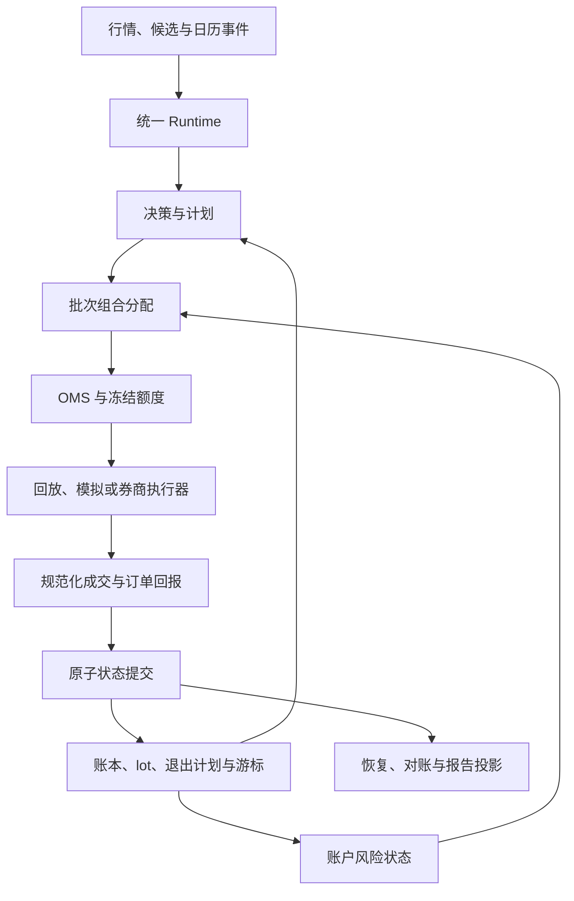

# price-action-lab 第六轮复审与整改验收清单

审阅日期：2026-10-13。审阅对象：RaiderYi/price-action-lab，main 分支提交 `1278929708aa13c80882ffee397737adaa75839e`。本轮完成时再次查询远端，HEAD 仍为该提交。

相对上轮 `8618b34`，本次审阅覆盖新增 `40e7926`、`1278929` 两个提交。采用独立 worktree，未修改仓库的业务代码或已跟踪测试样本。报告结论依据源码、默认测试、实际构建的 wheel 和独立故障/恢复反例；不依据状态文档中的 DONE 标签。

## 1. 审阅结论

**更新有实质进展，但“AR01–AR12 全部完成、B2 完成”的结论尚不成立。当前仍是正在整合的交易系统原型，尚未达到完整、可恢复、可审计的交易系统验收标准。**

最关键的四个问题：

1. 成交写入故障后，资金虽未先行扣减，但重试被重复订单阻断，交易事务仍不完整。
2. 多批持仓重启后只恢复最后一笔买入的退出计划，同一行情产生不同交易结果；现有对账还能报告成功。
3. 同日多次买入仍使用日期识别批次，退出计划可能扣错 lot。
4. 熔断只在尝试开仓时更新峰值，运行中已记录的净值高点未进入风控，超过回撤上限后仍可开仓。

此外，默认测试样本 hash、wheel 打包、OMS 接线、运行服务统一、批量分配和成交量共享约束均存在可复现缺口。

本轮不建议再次扩大模块数量。优先完成“已有模块共同处理一笔交易”的真实闭环，再推进真实数据、长期模拟和超额收益研究。

## 2. 实际执行结果

| 检查 | 实际结果 | 解释 |
|---|---|---|
| 原始提交默认 pytest | **534 passed / 7 failed / 6 warnings** | 与文档“541 passed / 0 failed”不符 |
| 提交样本文件校验 | **6/6 个输入文件 hash 不匹配** | Git 对象本身为 LF；manifest 的值与转换成 CRLF 后的字节匹配 |
| 临时目录重建验收包 | 成功加载 | 只用于区分样本问题与业务路径问题，没有替换仓库中的样本 |
| 重建包 backtest | 成功：1 笔买入、1 笔卖出 | 买入 8,300 @ 10.0，止损 8,300 @ 8.5 |
| 重建包最终现金/净值 | 987,476.3375 / 显示 987,476.34 | 人工止损场景，不能作为策略收益评估 |
| 重建包 reconcile | 通过 | 仅证明该路径的现金及总持仓一致 |
| 重建包 scan | awaiting_trigger=1、watch=1、rejected=1 | 三类状态比上轮正确；CLI 文案仍显示 armed=0，字段语义需说明 |
| 全段与按日分段 BacktestRunner | 事件和最终现金相同 | 上轮历史缓冲丢失问题已修复；这里是同一进程、同一 runner 的分段 |
| wheel 构建 | 构建成功，但缺 `pal.runtime`、`pal.oms` | 隔离导入报 `ModuleNotFoundError: No module named 'pal.runtime'` |

默认失败涉及 `tests/pal/test_round4_matrix.py` 中 3 项以及 `tests/pal/test_runtime_service.py` 中 4 项。根因是冻结样本校验失败及其下游产物缺失。默认配置显式排除了 `tests/integration`，该目录有 53 个文件；这不是“所有集成能力均已验证”。

本轮没有在替换样本后重新宣称“全套 541 项通过”；执行的是重建包上的 CLI 冒烟与独立反例。所有收益数字均来自合成数据，不代表真实市场收益。

## 3. 本轮确认已修复的内容

| 上轮问题 | 本轮独立复验 | 结论边界 |
|---|---|---|
| 未来日线改变过去的环境判断 | 无未来数据/追加 60 根未来日线均返回 `REGIME_BLOCK:unknown` | 此反例通过，不等于全部数据因果路径已证明 |
| 分段回放缺历史 | 全段和逐日同实例执行事件完全一致，现金均 987,476.3375 | 尚不能推导出跨进程恢复等价 |
| 重复 paper 输入报重复 bar | 同状态目录再次输入同一 bar 返回 NO_TRADES，现金不变 | 此幂等场景通过 |
| 单批持仓重启丢失退出能力 | 2,400 股恢复后按 8.5 止损，现金 996,378.70、持仓 0 | 多批持仓仍失败，见 R6-04 |
| 新批 T+1 计划串卖前一天旧批 | 返回 `EXIT_BLOCKED_T1_PLAN:new`，两个 lot 均保留 | 同日多个 lot 仍失败，见 R6-05 |
| 声明的输入文件缺失却放行 | 删除 manifest 声明的 daily 文件后明确拒绝 | 此缺文件场景通过 |
| scan 无法区分等待、无信号、拒绝 | 临时重建样本分别落入三类 | scan 的运行路径和当前/历史状态语义仍需统一 |
| 已武装计划在已知下跌环境中继续开仓 | 注入当时已知 downtrend 日线，触发价被碰到仍不成交 | 这是环境复查；不是完整 follow 确认 |
| allocator 完全未接主链 | `_try_fill` 已调用 allocator；Runtime 注入行业和 manifest 日历 | 组合批次、OMS 占用与熔断更新仍不完整 |

## 4. 剩余问题与具体整改任务

严重度定义：P0 直接破坏交易状态、恢复或核心风险约束，应阻断交易闭环验收；P1 阻断交付或系统级能力验收。编号 R6-01～R6-10 可直接作为下一轮任务号。

### R6-01｜P1｜冻结样本仍不具备跨环境可复现性

**证据**：`tests/fixtures/acceptance_pack/manifest.json` 中 6 个文件的 SHA-256 均不等于 Git 保存的原始字节；将 LF 转换成 CRLF 后全部匹配。直接检查 Git 对象得到同样结果，排除了仅为工作目录换行配置造成的问题。`write_bar_jsonl()` 当前仍以默认文本模式打开文件。

**位置**：`src/pal/research/acceptance_pack.py:38`；`tests/fixtures/acceptance_pack/`；仓库换行配置。

**整改**：固定 JSONL 的编码、序列化和 LF 字节；以固定字节计算 hash；为相关文件设置明确的 Git 换行策略；重新生成并提交样本及 manifest。不要删除 hash 校验，也不要在测试开始时静默改写损坏样本。

**验收**：全新 checkout 不运行生成脚本即可通过 hash 检查与默认 pytest；CI 直接检查 Git 提交中的字节；生成器跨环境得到相同输入 hash。

### R6-02｜P1｜新增运行服务和 OMS 没有进入安装包

**证据**：`pip wheel . --no-deps --no-build-isolation` 构建成功，但 wheel 中既没有 `pal/runtime/`，也没有 `pal/oms/`。将 wheel 解压到独立目录并以 `python -I` 导入 `pal.runtime.service`，立即失败。

**位置**：`pyproject.toml:40` 的手工 packages 列表。

**影响**：源码目录内测试可通过导入，用户按正常方式安装后却无法使用新的核心路径。构建成功不等于安装可用。

**整改**：采用正确的包发现规则或完整维护包列表；禁止安装验收依靠仓库 `src` 路径。

**验收**：构建 wheel，在临时虚拟环境安装声明的依赖和 wheel，工作目录切到仓库外；导入两个新增包并执行已安装的 `pal backtest`、`pal scan`、`pal paper` 冒烟。测试期间不得注入源代码 PYTHONPATH。

### R6-03｜P0｜先写 fill 的顺序改动没有形成可重试事务

**证据**：让 EventStore 在第一次 append(fill) 时抛出一次 OSError，随后恢复正常。

```text
第一次：OSError: injected one-shot fill write failure
现金 = 1,000,000；持仓 = 0；已消费 bar = 0
事件仓库已存在：session_init、order
同一输入重试：EventConflictError: 重复订单事件: order_id=ord_s
```

资金未先扣这一点已修复，但该 bar 仍无法成功重试。`EventStore.append()` 还在 fsync 之前修改去重索引；`_commit_consumed()` 在持久化消费事件前先修改内存游标，存在其他失败窗口。这两处为源码检查结论，本轮主反例只注入了一次 fill 写失败。

**位置**：`src/pal/pipeline/orchestrator.py:328`、`:200`；`src/pal/pipeline/event_store.py:73`。

**整改**：建立一笔业务处理的原子提交边界，覆盖订单/成交事实、lot、退出计划、资金变动、输入游标及版本信息。可采用 SQLite 事务加事件表及投影，或具备等价原子语义的持久机制。相同请求重试应返回已有结果；相同 ID、不同载荷应报告冲突。只有事务成功后才能发布新的内存状态。

**验收**：对订单、成交、账本、计划、游标的各个写入边界注入异常，并分别测试原进程重试与崩溃重启。每次结果只能是完整未提交或完整已提交；最终只能出现一份经济效果，且与无故障运行相同。

### R6-04｜P0｜多批持仓恢复不完整，现有对账发现不了

**证据**：通过真实 `_try_fill` 路径，分两天各买入 2,400 股 @ 10，分别绑定止损 9 的计划。恢复前现金 951,988、持仓 4,800。下一根行情跳空到 8.5。

| 运行方式 | 卖出 | 最终现金 | 剩余持仓 |
|---|---:|---:|---:|
| 同一会话连续执行 | 2,400 + 2,400 | 992,757.40 | 0 |
| 从事件文件通过 paper 重启 | 2,400 | 972,372.70 | 2,400 |

**重启分支随后执行 reconcile，仍返回 OK。** 这说明当前对账检查能验证自身产生的现金/总持仓，却不能验证是否漏恢复了应执行的退出计划。

**根因**：`_cmd_paper` 将一只股票所有净持仓压成一个恢复 lot，并用 `my_buys[-1]` 的日期、成本和计划替代其余批次。交易恢复逻辑位于 CLI，而非统一状态恢复服务。

**位置**：`src/pal_cli.py:423`；`src/pal/pipeline/event_store.py:154`。

**整改**：按真实 fill→lot→plan 关联重放每笔买卖及剩余数量。恢复现金、费用、lot 成本与可卖日、所有退出计划、待成交订单及占用、armed/setup 状态、行情历史或其可重建引用、价格缓存、业务时钟、消费游标、风控峰值和日初净值。已有退出记录必须扣减对应 lot/plan，不能只读取最后一次买入。

**验收**：同一事件流分别连续执行、逐日执行、每个事件后重启执行，比较完整领域状态与后续输出；包含多股票、多批次、部分卖出及持仓跨日场景。以上 4,800 股案例必须全部卖出且现金一致。现金/数量对账与恢复等价检查分别报告，不能混用“通过”。

### R6-05｜P0｜买入日期不是 lot 的唯一身份

**证据**：同一天先买 100 股 @ 10，再买 100 股 @ 11。第一计划止损 8，第二计划止损 9.5。次日仅触发第二计划。

实际输出 `EXIT_STOP:100@9.5` 后，剩余 lot 的含费成本是 11.05，但剩余计划是 `first`。应退出的第二批未被扣除，反而扣掉了第一批。同票、同日、同数量还产生相同 `lot_id`。

**位置**：`src/pal/ledger/positions.py:78`、`:139`；`src/pal/pipeline/orchestrator.py:435`。

**整改**：让 lot_id 来源于唯一 fill 或唯一成交分配记录；退出计划显式关联 lot_id 或 lot 分配明细。日期只用于可卖性规则，不能充当关联主键。卖出事件保存实际扣减的 lot 和数量。

**验收**：同票同日两笔相同数量、不同价格、不同止损，仅退出指定批次；剩余成本、计划、数量必须逐项匹配。再加入部分成交、部分退出、重启恢复验证。

### R6-06｜P1｜OMS 被实例化，但交易链路仍绕过它

**证据**：真实主链完成两笔买入后：

```text
events = [FILL:first:2400@10, FILL:second:2400@10]
orch.oms.orders = {}
orch.oms.reservations = {}
```

`_try_fill` 自行构造局部 Order，直接 transition/apply_fill/append；退出路径也自行构造局部 Order。没有通过 OMS submit/apply_fill 驱动。allocator 的调用没有读取 OMS 资金冻结。

新增 OMS 本身还存在待完成项：fill 与 cancel 不持久化完整生命周期；构造时不恢复订单/冻结；instrument_id 从 plan_id 解析或通过 order_id 子串过滤；部分成交后占用查询仍返回整笔初始额度。它需要完整业务契约，而不仅是独立单测。

**位置**：`src/pal/oms/service.py:39`；`src/pal/pipeline/orchestrator.py:118`、`:328`、`:435`。

**整改**：OMS 成为唯一订单状态所有者，买卖单均经其提交；执行器只产生成交/拒绝/撤单回报，账本只消费规范化回报。instrument_id 必须显式建模。冻结现金、剩余风险、部分成交转换及撤单释放进入事务和恢复路径。

**验收**：经公开 Runtime 输入产生订单；断言 OMS 中订单的数量、状态和 fill 关联与持久记录完全一致。再测试一单多成交、成交回报重复、撤单/成交竞态、拒单释放、资金冻结、重启恢复。不得用“直接调用 OMS 的单测通过”替代主链验收。

### R6-07｜P1｜统一 Runtime 当前只接入 backtest

**证据**：CLI backtest 调用 TradingRuntime；scan 仍自己构建 SessionOrchestrator、候选、日历和历史；paper 仍独立恢复并调用 `on_bar(..., [], [], None)`。新建 paper 状态时没有候选和背景输入，已有公开入口无法从零产生策略入场。

直接向新 paper 输入验收样本的 30m 行情，结果为现金 100 万、持仓空、NO_TRADES。这个结果本身不是回测/模拟“同输入不一致”的严格证明，因为 paper 的接口没有提供同等候选和日线；它证明的是统一输入契约尚未完成。scan 仍会执行模拟账户的成交/退出路径，也不等于独立的决策投影。

**位置**：`src/pal_cli.py:216`、`:323`、`:423`；`src/pal/runtime/service.py:94`。

**整改**：明确统一 Runtime 的事件、快照、候选、日历、配置与恢复接口；CLI 只解析参数和呈现结果。backtest/paper 使用相同决策、订单、风控、账本逻辑，差异限定为数据来源、执行适配和账户身份。scan 复用决策服务并投影解释，不创建模拟成交来判断候选当前状态。

**验收**：在相同策略版本、相同当时可知输入、相同模拟执行规则下，backtest 与 paper 的决策、订单、成交、账本和恢复状态一致；scan 输出相同决策含义且无账户/订单副作用。输入缺候选或背景时返回明确阻断原因，不能把“未评估”表现为普通无交易。

### R6-08｜P1｜多股票仍逐票抢额度，没有形成组合批次

**证据**：两只股票在完全相同 available_at/bar_start 触发，账户只允许一个持仓名额。Runtime 输入顺序为 A→B 时买 A，反转为 B→A 时买 B；两次均成交 2,400 股。

排序键仅 `(available_at, bar_start)`，相同时保留到达顺序；allocator 每次只收到一条请求，其内部 score/ID 排序无法决定多股票之间的竞争。

**位置**：`src/pal/runtime/service.py:133`；`src/pal/pipeline/orchestrator.py:328`；`src/pal/portfolio/allocator.py:76`。

**整改**：显式定义决策批次及结束条件；先收集同一批候选/触发计划，再统一评分、排序、分配现金和风险，最后提交订单。确定迟到数据、缺票、水位线和超时规则。添加 iid 稳定排序只能消除一个反例，不能替代真正的批量分配和占用管理。

**验收**：至少三只股票争夺不足资金或名额；对批内所有到达顺序以及不同输入切片运行，得到相同的获批订单和额度，或有事先声明且可解释的时间优先规则。持仓、行业、单票、待成交风险共享一份预算。

### R6-09｜P0｜熔断没有消费完整净值时间序列

**证据**：合成行情使主链记录的净值最高达到 1,119,994，随后降到 999,994，回撤约 10.714%，超过配置的 10%。此时另一票仍产生 `FILL:second:2400@10`。breaker 记录的峰值只有 1,000,000。

该用例故意构造极端价格，只用于验证熔断接线，不是 A 股真实价格路径或收益样本。

**根因**：allocator 的 `open_allowed(nav)` 只在开仓申请时更新峰值；orchestrator 每根行情生成的 NAV 没有持续送给 breaker。主链也没有调用 `on_day_rollover`，日初净值缺少实际交易日切换。

**位置**：`src/pal/pipeline/orchestrator.py:200`；`src/pal/portfolio/allocator.py:98`；`src/pal/portfolio/risk.py:181`。

**整改**：RiskState 消费每个规定估值时点的账户 NAV，按真实交易日更新日初净值，记录并持久化峰值、熔断原因、解除条件及人工覆盖；报价缺失/陈旧也必须有明确策略。开仓只查询已更新的风险状态，退出继续执行。

**验收**：无新信号期间出现净值峰值与回撤，随后开仓必须被阻断；跨日与重启不丢峰值、不沿用错误日初净值；日亏损、回撤和数据故障分别测试，且已持仓仍可退出。

### R6-10｜P1｜成交量上限没有在同票同 bar 的所有订单间共享

**证据**：一根 bar 成交量 1,000 股，参与率上限 10%；同票两个已武装计划各成交 100 股，总成交 200 股，超过账户这根 bar 的 100 股上限。两个计划还分别获取风险预算，缺少批内同票合并。

买入撮合每次独立计算容量；退出只检查零量/一字棒等情况，未共享同一参与率预算。后者为源码检查结论。

**位置**：`src/pal/pipeline/orchestrator.py:88`、`:328`、`:435`；`src/pal/oms/service.py`。

**整改**：执行模拟器按 instrument+bar 维护共享可成交预算，买卖执行策略明确；OMS 保留剩余量并执行预先确定的有效期/撤单政策。风险预算、流动性预算与资金预算分别建模并关联。

**验收**：多策略/多计划/多订单总成交不超过该 bar 的允许容量；低量退出允许部分成交并保留剩余退出计划；重复回报和重启不重复消耗容量或扩大可卖数量。

## 5. 架构落地状态及下一步收敛方式

上一轮完整架构蓝图的方向仍适用，当前缺口主要在接线、状态归属与事务语义。本轮不需要再建立另一套平行框架。

| 能力 | 当前实际状态 | 应收敛到的唯一职责 |
|---|---|---|
| 输入解析/候选/日历 | Runtime 与 CLI 并存 | 数据服务提供有版本、当时可知的标准事件 |
| 决策 | DecisionEngine + orchestrator | 输出决策与计划，不自行拥有账户真相 |
| 组合分配 | 已调用，但一次一条 | 批次级计划→目标订单与风险/现金预算 |
| 订单状态 | 局部 Order 与空 OMS 并存 | OMS 独占状态，执行器只回报 |
| 账本/lot/退出关联 | 账本与 paper 重建逻辑分叉 | 同一组事件处理函数更新完整领域状态 |
| 持久化 | 多次 JSONL append + 内存写 | 一个业务事务原子提交；外部执行使用 outbox |
| 风控 | 开仓时抽样更新 | 持续估值→RiskState→开仓闸门 |
| 报告/对账 | 现金与总量投影为主 | 只读完整已提交状态，区分财务对账和恢复一致性 |

建议的最小闭环如下；各节点是职责边界，不要求拆成微服务。



券商模式需要另外处理外部请求结果未知、断线查询与成交补录。数据库事务不能覆盖券商端，必须通过幂等请求、outbox、查询与对账解决；这属于后续真实执行接入，不能拿来替代眼前离线交易闭环的修复。

## 6. 交给执行 AI 的任务顺序

每个任务以端到端行为验收，修复后更新真实状态。不要为了获得绿灯删去失败样本、关闭校验、缩小输入范围或只增加未接入的类。

| 批次 | 必做事项 | 出口条件 |
|---|---|---|
| A：可信交付基线 | R6-01、R6-02；纠正当前状态文档 | 干净 checkout 默认测试通过；安装 wheel 可在仓库外跑通公开入口 |
| B：交易事实与身份 | R6-03、R6-05；定义 order/fill/lot/plan 身份与事务 | 故障重试没有半状态；lot 不串扣；相同输入只有一份经济效果 |
| C：完整恢复与真实 OMS | R6-04、R6-06 | 多批持仓、部分成交和撤单在重启后保持语义；OMS 真正拥有所有订单 |
| D：统一路径与组合风控 | R6-07～R6-10 | 模式一致、批次一致、熔断可靠、共享容量及冻结额度可靠 |
| E：研究和运行验收 | 真实数据、策略规格、OOS、持续 paper、运行监控 | 能以冻结证据说明系统正确性与策略表现，各自单独验收 |

批次 B/C 可作为同一次整体实现，但不能只完成字段增加便宣布结束。批次 A 的通过不代表系统已具备实盘能力；默认测试全部通过也不能替代本报告的反例验收。

推荐提交顺序：先加入会失败的系统级回归案例，再完成最小修复，最后在源码环境及安装环境执行。每个完成项记录 commit、复验命令、输入快照版本和结果路径。

下一轮至少必须展示以下 12 项证据：

- [ ] 干净 checkout 的冻结文件 hash 与 manifest 完全一致。
- [ ] 默认 pytest 无失败，并单独列出未执行的外部集成范围。
- [ ] wheel 安装后脱离源码目录执行成功。
- [ ] 每个交易写入边界中断后，重试或重启均得到完整一致状态。
- [ ] 两批共 4,800 股的恢复反例与连续运行完全一致。
- [ ] 同日同票同数量不同计划不会串扣 lot。
- [ ] 连续、分段、逐事件重启后的完整状态与后续输出一致。
- [ ] 真实主链的买单、卖单、部分成交、撤单在 OMS 中可追溯。
- [ ] backtest/paper 的同配置同输入决策及经济结果一致；scan 无账户副作用。
- [ ] 多股票批内输入排列和切片变化不意外改变获配结果。
- [ ] 无新单期间的净值峰值、跨日亏损、重启后的风控状态正确。
- [ ] 同票同 bar 多订单共享容量，未成交部分仍受 OMS 和退出计划管理。

## 7. 完整交易系统与超额收益的剩余距离

这两类验收必须分开：工程验收回答“系统是否按规则交易且可恢复”，研究验收回答“这些规则是否在未知数据上有稳定的净优势”。任何模块数、单测数或合成样本都不能证明超额收益。

在以上 P0/P1 收敛后，仍需完成：

1. **冻结策略规格**：入池条件、H2/突破定义、环境门、跟随确认、有效期、加仓、退出、冲突处理、打分与配置版本。当前主链没有调用 `assess_with_follow_bars`；若跟随是策略要求，应接入并明确确认后何时允许成交；若选择纯 buy-stop 突破，应明确标记策略差异，不能在文档中把两者视为同一实现。
2. **真实可交易数据**：历史股票池与退出市场的股票、复权与公司行动、交易日历、停牌/ST/涨跌停、行业历史、字段发布与可用时点、数据修订和质量阻断。不得将静态股票列表视为历史可交易股票池。
3. **防止研究泄漏**：冻结研究假设和参数选择流程，采用时间序列训练/验证/最终保留样本；重叠标签按其跨度处理隔离；记录尝试过的策略、筛选和参数，避免只展示最佳结果。
4. **净收益和基准**：预先规定可比基准及再平衡方式，扣除费用、滑点、成交容量与不可成交影响。报告收益、回撤、波动、换手、暴露、集中度、容量及分阶段表现；评估相对基准的超额收益，并解释市场暴露等来源。
5. **持续模拟运行**：用连续真实事件和冻结策略运行，记录每天的数据完整性、计划、订单、成交、持仓、资金、风控、重启与对账结果；真实运行观察窗口和准入阈值应预先确定。
6. **运营与执行**：监控、告警、备份、迁移、启动恢复、自检、暂停新仓、强制退出的权限与审计；后续才是受限资金规模的券商联调和执行验收。

本次没有运行真实券商、接入私有策略依赖或完成真实市场 OOS 检验。当前合成样本的 987,476.34 是故意构造的止损结果，不能据此判定策略有或没有 alpha。

## 8. 审阅依据

- [审阅提交](https://github.com/RaiderYi/price-action-lab/commit/1278929708aa13c80882ffee397737adaa75839e)
- [状态声明](https://github.com/RaiderYi/price-action-lab/blob/1278929708aa13c80882ffee397737adaa75839e/IMPLEMENTATION_STATUS.md)
- [orchestrator 主链](https://github.com/RaiderYi/price-action-lab/blob/1278929708aa13c80882ffee397737adaa75839e/src/pal/pipeline/orchestrator.py)
- [运行服务](https://github.com/RaiderYi/price-action-lab/blob/1278929708aa13c80882ffee397737adaa75839e/src/pal/runtime/service.py)
- [OMS](https://github.com/RaiderYi/price-action-lab/blob/1278929708aa13c80882ffee397737adaa75839e/src/pal/oms/service.py)
- [CLI 与恢复逻辑](https://github.com/RaiderYi/price-action-lab/blob/1278929708aa13c80882ffee397737adaa75839e/src/pal_cli.py)
- [EventStore 与对账](https://github.com/RaiderYi/price-action-lab/blob/1278929708aa13c80882ffee397737adaa75839e/src/pal/pipeline/event_store.py)
- [账本与 lot](https://github.com/RaiderYi/price-action-lab/blob/1278929708aa13c80882ffee397737adaa75839e/src/pal/ledger/positions.py)
- [组合分配](https://github.com/RaiderYi/price-action-lab/blob/1278929708aa13c80882ffee397737adaa75839e/src/pal/portfolio/allocator.py)
- [风控](https://github.com/RaiderYi/price-action-lab/blob/1278929708aa13c80882ffee397737adaa75839e/src/pal/portfolio/risk.py)
- [打包与测试配置](https://github.com/RaiderYi/price-action-lab/blob/1278929708aa13c80882ffee397737adaa75839e/pyproject.toml)

证据类型说明：仓库位置与控制流结论来自上述固定提交；数值反例来自本轮实际执行。独立反例包含手工构造计划、持仓或合成行情，用于验证系统不变量，不作为策略有效性证据。

## 附录 A：本轮独立复验结果

以下结果保留关键状态，方便执行 AI 将其转成正式回归用例。

```json
{
  "tracked_hashes": {
    "bars_SSE_600519.jsonl": {
      "raw_matches": false,
      "crlf_matches": true
    },
    "daily_SSE_600519.jsonl": {
      "raw_matches": false,
      "crlf_matches": true
    },
    "bars_SZSE_000001.jsonl": {
      "raw_matches": false,
      "crlf_matches": true
    },
    "daily_SZSE_000001.jsonl": {
      "raw_matches": false,
      "crlf_matches": true
    },
    "bars_SZSE_300750.jsonl": {
      "raw_matches": false,
      "crlf_matches": true
    },
    "daily_SZSE_300750.jsonl": {
      "raw_matches": false,
      "crlf_matches": true
    }
  },
  "generated_pack_load": "OK",
  "backtest": {
    "exit": 0,
    "stdout": "backtest OK: run=run_20261013_095534_fa6364 days=4 fills=2 events=27 nav=987476.34\n  events : {evidence_dir}/backtest/events.jsonl\n  ledger : {evidence_dir}/backtest/ledger_snapshot.json",
    "stderr": ""
  },
  "scan": {
    "exit": 0,
    "stdout": "scan OK: run=run_20261013_095534_d77e5c armed=0 evaluated=3\n  report: {evidence_dir}/scan/daily_plan.md",
    "stderr": ""
  },
  "paper_fresh": {
    "exit": 0,
    "stdout": "paper NO_TRADES: run=run_20261013_095534_43a97d new_events=0 cash=1000000.00 positions={} \n  state  : {evidence_dir}/paper_fresh",
    "stderr": ""
  },
  "backtest_reconcile": {
    "exit": 0,
    "stdout": "reconcile OK: 事件重放与账本快照一致 (cash=987476.3375, positions={'SSE.600519': 0})",
    "stderr": ""
  },
  "causal_gate": {
    "without_future": [
      "REGIME_BLOCK:unknown"
    ],
    "with_future": [
      "REGIME_BLOCK:unknown"
    ]
  },
  "cross_day_lots": {
    "events": [
      "EXIT_BLOCKED_T1_PLAN:new"
    ],
    "lots": [
      {
        "lot_id": "lot_SSE.600519_2026-10-12_100",
        "instrument_id": "SSE.600519",
        "qty": 100,
        "cost_price": 10.05,
        "acquired_date": "2026-10-12",
        "sellable_from": "2026-10-13"
      },
      {
        "lot_id": "lot_SSE.600519_2026-10-13_100",
        "instrument_id": "SSE.600519",
        "qty": 100,
        "cost_price": 10.05,
        "acquired_date": "2026-10-13",
        "sellable_from": "2026-10-14"
      }
    ]
  },
  "same_day_lots": {
    "events": [
      "EXIT_STOP:100@9.5"
    ],
    "lots": [
      {
        "lot_id": "lot_SSE.600519_2026-10-12_100",
        "instrument_id": "SSE.600519",
        "qty": 100,
        "cost_price": 11.05,
        "acquired_date": "2026-10-12",
        "sellable_from": "2026-10-13"
      }
    ],
    "plans": [
      "first"
    ]
  },
  "fill_write_retry": {
    "first": {
      "ok": false,
      "error": "OSError: injected one-shot fill write failure"
    },
    "cash_after_failure": 1000000,
    "qty_after_failure": 0,
    "consumed_after_failure": 0,
    "retry": {
      "ok": false,
      "error": "EventConflictError: 重复订单事件: order_id=ord_s"
    },
    "persisted_kinds": [
      "session_init",
      "order"
    ]
  },
  "oms_after_two_real_fills": {
    "events": [
      "FILL:first:2400@10",
      "FILL:second:2400@10"
    ],
    "orders": [],
    "reservations": []
  },
  "paper_multi_lot": {
    "before": {
      "cash": 951988.0,
      "qty": 4800
    },
    "continuous_events": [
      "EXIT_STOP:2400@8.5",
      "EXIT_STOP:2400@8.5"
    ],
    "continuous": {
      "cash": 992757.4000000001,
      "qty": 0
    },
    "restart": {
      "exit": 0,
      "stdout": "paper OK: run=run_20261013_095534_415b18 new_events=1 cash=972372.70 positions={'SSE.600519': 2400} (recovered)\n  state  : {evidence_dir}/paper_multi_lot",
      "stderr": ""
    },
    "recovered": {
      "cash": 972372.7,
      "positions": {
        "SSE.600519": 2400
      }
    },
    "reconcile": {
      "exit": 0,
      "stdout": "reconcile OK: 事件重放与账本快照一致 (cash=972372.7, positions={'SSE.600519': 2400})",
      "stderr": ""
    },
    "duplicate_input": {
      "exit": 0,
      "stdout": "paper NO_TRADES: run=run_20261013_095534_f3af89 new_events=0 cash=972372.70 positions={'SSE.600519': 2400} (recovered)\n  state  : {evidence_dir}/paper_multi_lot",
      "stderr": ""
    }
  },
  "paper_single_lot": {
    "exit": 0,
    "stdout": "paper OK: run=run_20261013_095534_bf10d8 new_events=1 cash=996378.70 positions={'SSE.600519': 0} (recovered)\n  state  : {evidence_dir}/paper_single_lot",
    "stderr": ""
  },
  "whole_vs_incremental": {
    "events_equal": true,
    "events_per_run": 27,
    "whole_cash": 987476.3375,
    "incremental_cash": 987476.3375
  },
  "batch_order": {
    "forward": {
      "events": [
        "FILL:s_SSE.600519:2400@10",
        "REGIME_BLOCK:unknown",
        "NO_CAPACITY:s_SZSE.000001:('REJ_MAX_POSITIONS',)",
        "REGIME_BLOCK:unknown"
      ],
      "ledger": {
        "cash": 975994.0,
        "positions": {
          "SSE.600519": 2400
        }
      }
    },
    "reversed": {
      "events": [
        "FILL:s_SZSE.000001:2400@10",
        "REGIME_BLOCK:unknown",
        "NO_CAPACITY:s_SSE.600519:('REJ_MAX_POSITIONS',)",
        "REGIME_BLOCK:unknown"
      ],
      "ledger": {
        "cash": 975994.0,
        "positions": {
          "SZSE.000001": 2400
        }
      }
    }
  },
  "missing_declared_input": {
    "ok": false,
    "error": "RuntimeError_: 声明的输入文件缺失: daily_SSE_600519.jsonl"
  },
  "scan_summary": {
    "admitted": 0,
    "awaiting_trigger": 1,
    "watch": 1,
    "rejected": 1
  },
  "wheel": {
    "file": "price_action_lab-0.1.0-py3-none-any.whl",
    "has_runtime": false,
    "has_oms": false,
    "isolated_import": {
      "exit": 1,
      "stderr": "Traceback (most recent call last):\n  File \"<string>\", line 1, in <module>\nModuleNotFoundError: No module named 'pal.runtime'"
    }
  },
  "shared_bar_volume": {
    "volume": 1000,
    "participation": 0.1,
    "events": [
      "FILL:a:100@10",
      "FILL:b:100@10"
    ],
    "filled_qty": 200
  },
  "breaker_peak_tracking": {
    "observed_peak_nav": 1119994.0,
    "pre_buy_nav": 999994.0,
    "drawdown": 0.10714343112552388,
    "limit": 0.1,
    "breaker_peak_nav": 1000000.0,
    "events": [
      "FILL:second:2400@10"
    ]
  }
}
```

## 附录 B：可复用的独立复验脚本

在该提交的仓库根目录，安装项目声明依赖、pytest 和构建依赖后，将下方代码保存为 `review6_checks.py`，执行 `PYTHONPATH=src python review6_checks.py`。脚本在独立临时目录生成样本、状态与 wheel，不改写提交中的样本。返回值是诊断结果；正式验收应将以上明确期望写成断言，不能把“脚本未崩溃”当作通过。

脚本覆盖默认样本 hash、临时包 CLI、未来日线隔离、批次退出、写故障重试、多批持仓恢复、OMS 主链、分段回放、组合输入顺序和安装包检查。熔断与共享容量的补充反例参数及结果见附录 A 和 R6-09/R6-10。

```python
import json, subprocess, sys, shutil, hashlib, zipfile, tempfile
from pathlib import Path
from datetime import datetime, date, time, timedelta
from dataclasses import replace, asdict
from pal.data.bars import Bar
from pal.data.calendar import TZ, TradingCalendar
from pal.pipeline.orchestrator import SessionOrchestrator, OrchestratorConfig, ArmedSetup, PositionPlan
from pal.pipeline.event_store import EventStore, replay_events
from pal.signals.engine import EngineConfig
from pal.ledger.positions import AccountLedger
from pal.execution.market_rules import MAIN_BOARD
from pal.selection.providers import Candidate
from pal.research.acceptance_pack import breakout_bars, build_pack, write_bar_jsonl
from pal.research.backtest_runner import BacktestDay, BacktestRunner
from pal.runtime.service import TradingRuntime, load_snapshot
from pal.portfolio.allocator import PortfolioAllocator
from pal.portfolio.risk import PaperDefaults

OUT=Path(tempfile.mkdtemp(prefix='pal-review6-'))
OUT.mkdir(exist_ok=True)
IID='SSE.600519'; T=datetime(2026,10,13,10,0,tzinfo=TZ)
def bar(t=T,o=10,h=10.5,l=9.8,c=10.2,v=100000,iid=IID):
    return Bar(iid,'30m',t,t+timedelta(minutes=30),t+timedelta(minutes=30),o,h,l,c,v)
def qnew(store=None):
    q=SessionOrchestrator(OrchestratorConfig(EngineConfig('r6',enabled_families=('breakout',))),AccountLedger(1_000_000),store=store)
    q._industries={IID:'test'}
    return q
def arm(q,sid='s',entry=10,stop=9,target=12,iid=IID,armed_at=T-timedelta(minutes=30)):
    q.armed[sid]=ArmedSetup(sid,iid,'breakout',entry,stop,target,armed_at)
def cli(*args):
    p=subprocess.run([sys.executable,'src/pal_cli.py',*map(str,args)],capture_output=True,text=True)
    return {'exit':p.returncode,'stdout':p.stdout.strip(),'stderr':p.stderr.strip()[-1000:]}
def attempt(fn):
    try: return {'ok':True,'value':fn()}
    except Exception as e: return {'ok':False,'error':f'{type(e).__name__}: {e}'}
out={}
fixture=Path('tests/fixtures/acceptance_pack')
man=json.loads((fixture/'manifest.json').read_text())
out['tracked_hashes']={fn:{'raw_matches':hashlib.sha256((fixture/fn).read_bytes()).hexdigest()==h,'crlf_matches':hashlib.sha256((fixture/fn).read_bytes().replace(b'\n',b'\r\n')).hexdigest()==h} for fn,h in man['file_sha256'].items()}
build_pack(str(OUT/'generated_pack'))
si=load_snapshot(str(OUT/'generated_pack'))
out['generated_pack_load']='OK'
out['backtest']=cli('backtest','--snapshot',OUT/'generated_pack','--out',OUT/'backtest')
out['scan']=cli('scan','--snapshot',OUT/'generated_pack','--out',OUT/'scan')
out['paper_fresh']=cli('paper','--events',OUT/'generated_pack/bars_SSE_600519.jsonl','--state',OUT/'paper_fresh')
out['backtest_reconcile']=cli('reconcile','--run',OUT/'backtest')
# Causal filtering: future daily data must not alter a past decision.
bs=breakout_bars(); sig=bs[21]; hist=bs[:21]
at=sig.bar_start.replace(hour=0,minute=0)
cand=Candidate('c',IID,('static_pool',),at,at,None)
future=[]
for i in range(60):
    s=datetime(2026,11,1,9,30,tzinfo=TZ)+timedelta(days=i); e=s.replace(hour=15,minute=0)
    future.append(Bar(IID,'1d',s,e,e,10,10.1,9.9,10,100000))
out['causal_gate']={'without_future':qnew().on_bar(IID,sig,hist,[],cand),'with_future':qnew().on_bar(IID,sig,hist,future,cand)}
# Cross-day lot selection fix.
q=qnew()
q.ledger.buy(IID,100,10,date(2026,10,12),MAIN_BOARD,date(2026,10,13))
q.ledger.buy(IID,100,10,date(2026,10,13),MAIN_BOARD,date(2026,10,14))
q.position_plans[IID]=[PositionPlan(IID,'old',10,8,20,date(2026,10,12),100),PositionPlan(IID,'new',10,9.5,20,date(2026,10,13),100)]
out['cross_day_lots']={'events':q.on_bar(IID,bar(o=9.6,h=10,l=9,c=9.7),[],[],None),'lots':[asdict(l) for l in q.ledger.positions._lots[IID]]}
# Same-day distinct lot plans still collide on acquired_date.
q=qnew()
q.ledger.buy(IID,100,10,date(2026,10,12),MAIN_BOARD,date(2026,10,13))
q.ledger.buy(IID,100,11,date(2026,10,12),MAIN_BOARD,date(2026,10,13))
q.position_plans[IID]=[PositionPlan(IID,'first',10,8,20,date(2026,10,12),100),PositionPlan(IID,'second',11,9.5,20,date(2026,10,12),100)]
out['same_day_lots']={'events':q.on_bar(IID,bar(o=9.6,h=10,l=9,c=9.7),[],[],None),'lots':[asdict(l) for l in q.ledger.positions._lots[IID]],'plans':[p.setup_id for p in q.position_plans[IID]]}
# Retry after fill persistence fails once.
class FailingStore(EventStore):
    fail=True
    def append(self,kind,payload,ts=''):
        if kind=='fill' and self.fail:
            self.fail=False
            raise OSError('injected one-shot fill write failure')
        return super().append(kind,payload,ts)
es=FailingStore(); q=qnew(es); arm(q)
out['fill_write_retry']={'first':attempt(lambda:q.on_bar(IID,bar(),[],[],None)),'cash_after_failure':q.ledger.cash,'qty_after_failure':q.ledger.positions.total_qty(IID),'consumed_after_failure':len(q._consumed_bars),'retry':attempt(lambda:q.on_bar(IID,bar(),[],[],None)),'persisted_kinds':[e.kind for e in es.events()]}
# Persisted open positions: multi-lot restart vs uninterrupted next-day exit.
state=OUT/'paper_multi_lot'; state.mkdir(exist_ok=True)
es=EventStore(str(state/'events.jsonl')); q=qnew(es); arm(q,'first')
first=q.on_bar(IID,bar(),[],[],None)
arm(q,'second',armed_at=T+timedelta(hours=23))
second=q.on_bar(IID,bar(t=T+timedelta(days=1)),[],[],None)
out['oms_after_two_real_fills']={'events':first+second,'orders':list(q.oms.orders),'reservations':list(q.oms.reservations)}
out['paper_multi_lot']={'before':{'cash':q.ledger.cash,'qty':q.ledger.positions.total_qty(IID)}}
bnext=bar(t=T+timedelta(days=2),o=8.5,h=8.8,l=8,c=8.2)
fp=OUT/'next_day.jsonl'; write_bar_jsonl(str(fp),[bnext])
# Freeze store contents before continuous branch changes them.
q.store=None
out['paper_multi_lot']['continuous_events']=q.on_bar(IID,bnext,[],[],None)
out['paper_multi_lot']['continuous']={'cash':q.ledger.cash,'qty':q.ledger.positions.total_qty(IID)}
out['paper_multi_lot']['restart']=cli('paper','--events',fp,'--state',state)
out['paper_multi_lot']['recovered']=json.loads((state/'ledger_snapshot.json').read_text())
out['paper_multi_lot']['reconcile']=cli('reconcile','--run',state)
out['paper_multi_lot']['duplicate_input']=cli('paper','--events',fp,'--state',state)
# Single-lot case that the current update claims to fix.
state1=OUT/'paper_single_lot'; state1.mkdir(exist_ok=True)
es=EventStore(str(state1/'events.jsonl')); q=qnew(es); arm(q)
q.on_bar(IID,bar(),[],[],None)
out['paper_single_lot']=cli('paper','--events',fp,'--state',state1)
# Whole-run vs chunked BacktestRunner, same instance.
days=[]
for d in sorted({b.bar_start.date() for b in si['bars']}):
    bars=tuple(b for b in si['bars'] if b.bar_start.date()==d)
    at=datetime.combine(d,time(0),tzinfo=TZ)
    cands=tuple(Candidate(f'{i}-{d}',i,('static_pool',),at,at,None) for i in si['manifest']['instruments'])
    days.append(BacktestDay(d,bars,tuple(si['daily']),cands))
cal=TradingCalendar(tuple(date.fromisoformat(d) for d in si['manifest']['trading_days']),'r6')
cfg=OrchestratorConfig(EngineConfig('r6'),calendar=cal)
whole=BacktestRunner(cfg,1_000_000).run(days)
runner=BacktestRunner(cfg,1_000_000); ev=[]
for d in days: ev+=runner.run([d]).events
out['whole_vs_incremental']={'whole_events':whole.events,'whole_cash':whole.final_cash,'incremental_events':ev,'incremental_cash':runner.ledger.cash}
# Unified runtime ordering: same timestamp, one portfolio slot, reverse input.
def order_case(reverse=False):
    iids=[IID,'SZSE.000001']
    rb=[bar(iid=i) for i in iids]
    info={'manifest':{'instruments':{i:{'industry':i} for i in iids},'trading_days':['2026-10-13','2026-10-14']},'bars':rb,'daily':[]}
    rt=TradingRuntime(info)
    rt.orch.allocator=PortfolioAllocator(replace(PaperDefaults(),max_positions=1))
    for i in iids: arm(rt.orch,'s_'+i,iid=i)
    ev=rt.process_bars(list(reversed(rb)) if reverse else rb)
    return {'events':ev,'ledger':rt.ledger_snapshot()}
out['batch_order']={'forward':order_case(),'reversed':order_case(True)}
# Missing declared file must fail closed.
cop=OUT/'missing_input_pack'; shutil.copytree(OUT/'generated_pack',cop)
(cop/'daily_SSE_600519.jsonl').unlink()
out['missing_declared_input']=attempt(lambda:load_snapshot(str(cop)))
if (OUT/'scan/daily_plan.json').exists():
    out['scan_summary']=json.loads((OUT/'scan/daily_plan.json').read_text())['summary']
# Wheel must contain every new package, source-tree PYTHONPATH can mask this.
subprocess.run([sys.executable, '-m', 'pip', 'wheel', '.', '--no-deps', '--no-build-isolation', '-w', str(OUT/'wheels')], check=True)
wheel=next((OUT/'wheels').glob('*.whl'))
with zipfile.ZipFile(wheel) as z:
    names=z.namelist()
    out['wheel']={'file':wheel.name,'has_runtime':any(n.startswith('pal/runtime/') for n in names),'has_oms':any(n.startswith('pal/oms/') for n in names)}
    z.extractall(OUT/'wheel_unpacked')
p=subprocess.run([sys.executable,'-I','-c',f"import sys;sys.path.insert(0,{str(OUT/'wheel_unpacked')!r}); import pal.runtime.service"],cwd=str(OUT),capture_output=True,text=True)
out['wheel']['isolated_import']={'exit':p.returncode,'stderr':p.stderr.strip()}
(OUT/'review6_results.json').write_text(json.dumps(out,indent=2,ensure_ascii=False,default=str))
print(json.dumps(out,indent=2,ensure_ascii=False,default=str))

```
